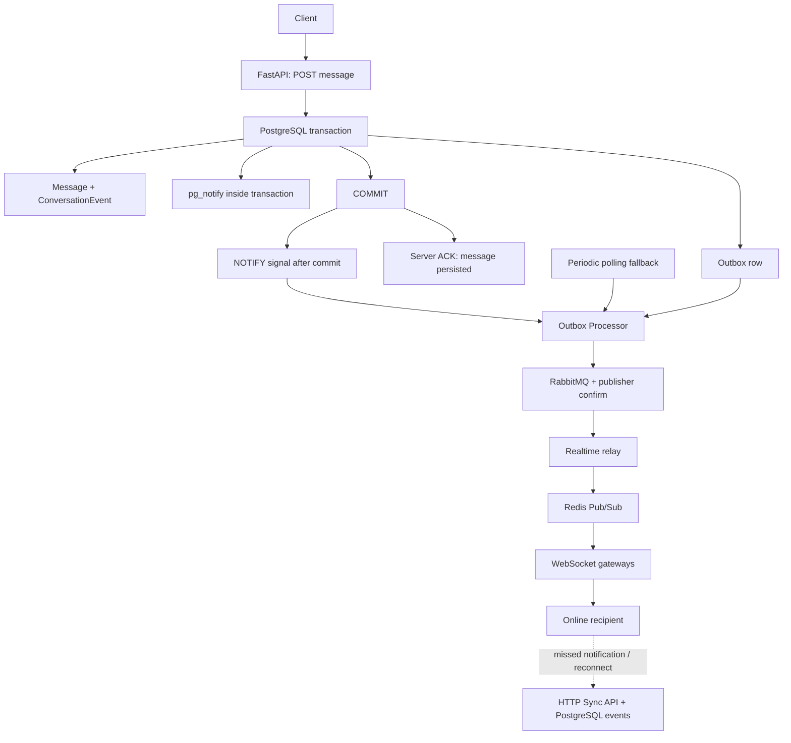

# ADR-0003 — Transactional Outbox для надёжной и быстрой доставки сообщений

- **Статус:** Accepted
- **Дата:** 2026-11-22
- **Область:** Message send path, reliability, realtime
- **Зависимости:** [ADR-0001](ADR-0001-service-boundary-and-storage.md), [ADR-0002](ADR-0002-http-websocket-and-sync.md)

## 1. Контекст

Стандартная проблема dual write: нельзя просто `INSERT Message` в PostgreSQL, а затем `PUBLISH` в RabbitMQ и считать обе операции атомарными при падении процесса. Уже существует инфраструктура DDF Transactional Outbox (`SqlAlchemyOutboxStore`, `OutboxProcessor`, `SKIP LOCKED`).

В мессенджере важна не только надёжность, но и p95 задержка появления сообщения у другого пользователя. Periodic polling таблицы outbox может добавить сотни миллисекунд. При этом **подтверждение отправителю** и **доставка онлайн-получателю** — разные события.

## 2. Решение

**Сохраняем Transactional Outbox, добавляем event-driven wakeup через PostgreSQL `LISTEN/NOTIFY`, оставляем periodic polling fallback.**

### 2.1. Sender ACK

- API делает authorization / policy checks.
- В одной транзакции сохраняются Message, ConversationEvent, Outbox, назначается per-conversation seq, регистрируется NOTIFY.
- После `COMMIT` API возвращает `201 Created` с canonical `message_id`, `created_seq`, `event_seq` и `created_at`.
- ACK **не ждёт** RabbitMQ publish, Outbox poll или WebSocket fan-out.
- Если transaction commit не завершился успешно / результат неизвестен клиенту, тот повторяет с тем же `client_message_id`. На сервере обязательный idempotency constraint и проверка payload.

### 2.2. NOTIFY signal

- `pg_notify()` выполняется **в той же PostgreSQL-транзакции**. PostgreSQL сигнализирует слушателям после commit; rollback не создаёт уведомление.
- Dedicated listener connection через `LISTEN messenger_outbox`; сигнал сообщает «есть работа», не переносит событие целиком.
- На пробуждении processor вычитывает доступные outbox rows пачками до разумного drain.
- `NOTIFY` **не durable**; `LISTEN` receiver может быть offline. Поэтому всегда работает периодическая проверка backlog (и проверка сразу после старта listener).
- В нескольких worker'ах возможны duplicate wakeups; `SKIP LOCKED` позволяет распределять work claims, но в обработке в целом действуют at-least-once semantics.

### 2.3. Надёжная публикация

- Worker публикует в RabbitMQ с publisher confirms; только после подтверждения отмечает outbox processed.
- Падение после publish, но до mark processed, приводит к повторной публикации. Consumers обязаны быть идемпотентными.
- Consumer/realtime relay пересылает notification через Redis Pub/Sub. Redis может терять notifications; durable sync stream и HTTP re-fetch гарантируют recovery.
- Для DDF следует добавить opt-in wakeup adapter: PostgreSQL notifier/listener без изменения гарантий `OutboxProcessor`.

## 3. Почему не Broker-first

Альтернатива `Client → RabbitMQ → ACK → Worker → PostgreSQL` позволяет быстро подтвердить **broker persistence**, но не DB commit. Это другой смысл `sent` и иная consistency model, требующая отдельной ordering/idempotency схемы, управления задержанными insert и контроля бизнес-инвариантов.

Broker-first разумен для систем с осознанно выбранным durable log of record; для нашего MVP не окупает усложнение.

## 4. Отклонённые и резервные альтернативы

| Подход | Решение | Причина |
|---|---|---|
| Periodic Outbox polling only | Допустимый fallback | p95 recipient delivery зависит от периода опроса |
| Outbox + LISTEN/NOTIFY | **Выбран** | Low latency + надёжный DB-backed event source |
| PostgreSQL CDC | Возможная оптимизация позднее | Инфраструктура и операционные издержки |
| Commit → Redis fast path + Outbox | Отложен | Два канала, дубликаты/reorder, дополнительная сложность |
| Broker-first | Не выбран | ACK не соответствует durable DB commit, другой protocol of record |

### Future fast path

При подтверждённом нарушении p95 допускается best-effort publish в Redis **после commit** параллельно надёжному Outbox пути. Не блокировать HTTP ACK. Один event_id должен дедуплицироваться на всех уровнях. `seq`-gap должен запускать reconciliation. Нет гарантий доставки fast-path уведомления.

## 5. Порядок и корректность

`SKIP LOCKED` не обеспечивает строгий per-conversation order событий, обрабатываемых разными workers. Клиент обрабатывает event IDs идемпотентно, применяет только непрерывную последовательность и восстанавливает gaps по HTTP. При росте нагрузки можно отдельно оптимизировать маршрутизацию по `conversation_id`.

Для incoming command применить стабильный client-side `client_message_id`. Потеря response после commit не должна создавать второе сообщение.

## 6. Производительность и тесты принятия

Измерять моменты:

- `t0`: API получил запрос;
- `t1`: PostgreSQL committed;
- `t2`: sender ACK;
- `t3`: outbox claimed;
- `t4`: RabbitMQ publisher confirm;
- `t5`: WS gateway received;
- `t6`: recipient applied event (при корректно согласованных часах/измерениях).

Главные показатели: `send_ack_latency = t2 - t0`, `outbox_lag = t3 - t1`, `recipient_delivery_latency = t6 - t0`. Клиентские задержки/clock skew учитывать отдельно.

Сравнить на одинаковой нагрузке: polling 500 мс, polling 50 мс, notify+polling fallback 500 мс; измерять p50/p95/p99, DB CPU/IO, скорость опустошения outbox, RabbitMQ redeliveries.

**Критические fault scenarios:**

1. Pod погиб после COMMIT до HTTP response — повтор по `client_message_id` не создаёт дубль.
2. Pod погиб после COMMIT до уведомления relay — outbox fallback доставляет событие.
3. NOTIFY потерян, listener перезапущен — periodic polling находит pending row.
4. Broker подтвердил publish, worker умер до mark processed — повторный publish безопасен.
5. Consumer получили события 105, потом 104 — клиент не перескакивает seq и восстанавливает согласованное состояние.
6. Redis недоступен во время отправки — историческое сообщение доступно через Sync API; при восстановлении доставки не теряется.

## 7. Последствия

**Преимущества:** одна durable truth в PostgreSQL, быстрый sender ACK, низкая задержка recipient при нормальной работе, reuse DDF, fail-safe fallback.

**Стоимость:** дополнительный listener, NOTIFY-нагрузка, мониторинг outbox age, отдельный тест порядок событий/дубликаты и sync recovery. Event-driven relay снижает ожидание polling, но не гарантирует конкретные миллисекунды без бенчмарка и подходящего HA deployment.
