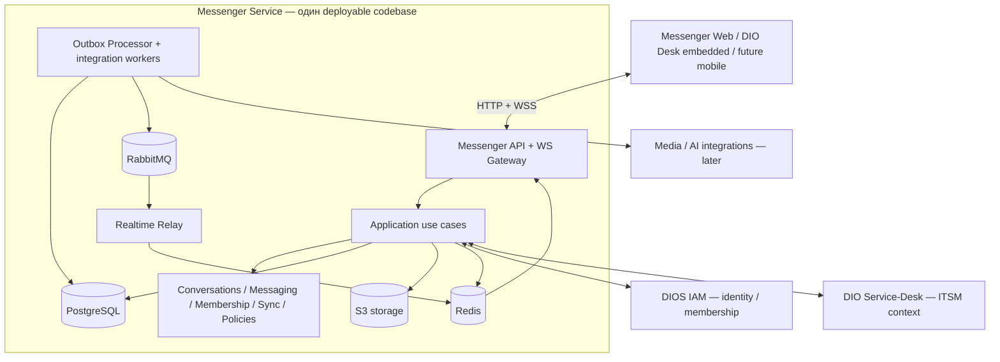

# DIO Messenger — MVP Architecture & Product Design

> **Статус:** согласованная архитектурная основа MVP  
> **Дата:** 2026-11-22  
> **Назначение:** единый документ продукта и технического дизайна  
> **Система:** DIO Messenger — коммуникационная платформа экосистемы DIOS, интегрированная с DIO Service-Desk  
> **Ссылки:** [Реестр документов](../README.md) · [ADR-0003: Outbox](../adr/ADR-0003-transactional-outbox-and-realtime.md) · [План](../development/IMPLEMENTATION_PLAN.md) · [Тестирование](../development/TEST_PLAN.md)

## 1. Контекст и продуктовая идея

**DIO Messenger** — встроенная коммуникационная платформа DIO Service-Desk для общения сотрудников, сервисных команд, заказчиков и подрядчиков. Разговор может связываться с объектами и процессами ITSM и превращаться в управляемую работу без переключения между системами.

MVP здесь означает **ограниченный объём функций, но production-oriented качество реализации**: явные инварианты, надёжная отправка и синхронизация, контроль доступа, наблюдаемость и тестируемость. «Костыльный прототип» не является целью.

### 1.1. Продуктовые отличия

1. **Нативный контекст ITSM.** В сообщении можно упомянуть инцидент/задачу, получить безопасное превью и, при наличии прав, выполнить действие (например, «Взять в работу»). Чат может быть привязан к рабочему объекту.
2. **Коммуникация как вход в рабочий процесс.** Сообщение заказчика «Не могу подключиться к VPN» может стать основанием для предложения создать заявку, но сама заявка создаётся через API Service-Desk с подтверждением пользователя и соответствующими правами.
3. **Гостевой контур.** В одной беседе могут присутствовать внутренние и внешние участники; граница безопасности видна в UI.
4. **Offline-first UX.** Отображение кешированной истории и ввод/отправка с локальной очередью без сети.
5. **AI-секретарь (следующий этап).** Суммаризация, поиск по контексту, транскрибация, извлечение решений, напоминания и рекомендации. Для клиентских бесед AI выключен по умолчанию и требует подходящего соглашения/разрешения.

### 1.2. Пример целевого UX

Пользователь вводит: «Андрюха опять токены все высушил…». Интерфейс предлагает связанные объекты:

```text
INC-228 · Ochen vazhnyi Incident
Token limit reached
P1 · SLA 00:18:42
Ответственный: Иванов И.И.
[Взять в работу] [Эскалировать] [Открыть]
```

**MVP:** явный поиск/упоминание по номеру и разрешённые превью. **Далее:** автоматические семантические подсказки и контекстное ранжирование; не запускать LLM на каждый `keydown`.

## 2. Scope и приоритеты

### 2.1. MVP Core (P0 для запуска)

- Личные и групповые беседы; создание чата, список бесед, участники и роли.
- Текстовые сообщения; reply, edit, delete, reactions, mentions, pins, forward с ACL.
- Вложения с безопасным жизненным циклом загрузки; аватары и базовые media variants (thumbnail/preview) в рамках того же media-контура.
- Поиск сообщений и базовые фильтры (conversation, sender, период).
- WebSocket realtime, typing, presence; read cursors (и delivery, если протокол подтверждений готов).
- Offline чтение кешированной истории, persistent черновики, persistent Outbox, повторная отправка и reconnect sync.
- Несколько вкладок/устройств, дедупликация, восстановление пропущенных событий.
- Организационная изоляция и явно приглашённые внешние участники (guest membership).
- Ручные ссылки на ITSM-объекты, проверяемые превью/действия; **автоматическое создание incident room по P1**; **рекомендация создать заявку из клиентского сообщения** (с подтверждением пользователя).
- Topics / threads (как отдельные сущности в рамках conversation), **опросы**, **scheduled messages**.
- Серверное применение политик, базовый audit и эксплуатационная наблюдаемость.

### 2.2. MVP+ (не блокирует первый запуск)

- Синхронизация черновиков между устройствами, напоминания, каналы / forum-style topics сверх базовых threads.
- Голосовые сообщения, транскрибация, AI-суммаризация и выделение решений (с согласиями).
- Автоматические семантические ITSM-подсказки (LLM ranking); не запускать LLM на каждый `keydown`.

### 2.3. Позже / отдельная подсистема

- Аудио/видеозвонки, screen sharing, видеокружки; stories не нужны для ранних этапов.
- Настраиваемые stickers/GIF, обогащённые корпоративные коммуникации.
- Cassandra **только при подтверждённой необходимости масштабирования**.

Исходные приоритеты продукта задают направление, а приведённое деление уточняет объём первого релиза. Финальная комплектация релиза может уточняться по пилотным сценариям, но **никакая экономия scope не отменяет корректности и безопасности**.

## 3. Нефункциональные требования и SLO

| Операция | Цель | Уточнение измерения |
|---|---:|---|
| Send → server ACK | p95 < 150–200 мс | От приёма запроса до HTTP ответа **после DB commit**; дополнительно измерять client-perceived RTT |
| Send → online recipient | p95 < 300–500 мс | До применения сообщения у клиента получателя; не включает гарантии offline-доставки |
| Open cached conversation | < 100 мс perceived | Время до первого отображения локально сохранённой истории |
| Pagination | p95 < 300 мс | Backend latency и UI render latency отслеживать отдельно |
| Search | p95 < 500 мс | С учётом scope ACL и ограниченной выдачи; прогнать на реалистичном объёме |
| Typing/reaction propagation | < 300 мс | Realtime latency |
| Reconnect after recovery | < 2 с | Для типичного восстановления online после краткой потери сети |
| Message delivery correctness | Цель 99.999% | Определить точный SLI: подтверждённые сообщения не теряются; delivery/reconciliation отдельно |
| Backend availability | >= 99.95%, enterprise 99.99% | Это цель инфраструктуры и эксплуатации, не гарантия одного процесса |

**Методология:** отдельно измерять backend internal latency, end-to-end latency и local UI latency. Числа — **целевые бюджеты**, не подтверждённые результаты тестов. Для offline, перегрузки и деградации инфраструктуры определить явные исключения и error budgets.

## 4. Выбранный технологический стек

| Слой | Выбор для MVP | Причина |
|---|---|---|
| Backend | Python 3.13+, FastAPI, DDF | Общая инфраструктура DIOS, async, готовые компоненты |
| OLTP / metadata / messages | PostgreSQL + SQLAlchemy async + Alembic | Транзакции, целостность, SQL, простой операционный контур |
| Realtime | Native WebSocket + DDF Realtime | ConnectionManager, комнаты, backpressure, subscriptions |
| Event backbone | RabbitMQ + DDF Transactional Outbox | Надёжные фоновые события и интеграции |
| Fast broadcast | Redis Pub/Sub | Быстрая межинстансная рассылка, **не источник истины** |
| Cache, presence | Redis | TTL, leases, transient состояния и возможные лимиты |
| Object storage | S3-compatible | Вложения отдельно от DB |
| Search | PostgreSQL FTS (`russian`, GIN) + `pg_trgm` | Достаточно для MVP; ACL на backend |
| Web | React + TypeScript + Vite | SPA + удобное встраивание в DIO Desk |
| Remote query orchestration | TanStack Query | Запросы и invalidation; не второй authoritative message store |
| Local database | IndexedDB + Dexie | Persistent messages, drafts, Outbox, sync cursors |
| Ephemeral UI state | Zustand | Активный чат, модальные панели, composer state |
| Long list rendering | TanStack Virtual | Virtualized message list и сохранение scroll anchor |
| Observability | OpenTelemetry, Prometheus, Grafana | Traces, metrics, dashboards, alerting |
| Mobile (после MVP) | React Native/Expo, локальная SQLite | Переиспользуемая логика, иной storage adapter |

Не добавлять Kafka, Cassandra, OpenSearch и отдельный realtime-микросервис без измеренной необходимости.

## 5. High-level architecture



**Deployment:** один самостоятельный `messenger` сервис с отдельной БД и API. HTTP, WS и workers могут запускаться отдельными процессами/репликами **одной кодовой базы** и независимо масштабироваться. Внутри — модули, а не коллекция мелких микросервисов.

**Интеграционные границы:** Messenger не читает напрямую таблицы IAM, Service-Desk или AI Chats. Используются проверяемые API, контракты и интеграционные события.

## 6. Backend modules и DDD

| Модуль | Ответственность |
|---|---|
| `conversations` | Тип беседы, жизненный цикл, настройки, создание |
| `memberships` | Участники, роли, guest status, join/leave/history visibility |
| `messaging` | Create/edit/delete/reply/forward, доменные инварианты |
| `interactions` | Reactions, pins, mentions |
| `receipts` | Per-member read/delivery cursors, unread |
| `sync` | Durable event history, cursor/snapshot/reconciliation |
| `realtime` | WebSocket sessions, subscriptions, typing/presence |
| `attachments` | Metadata, upload/scanning/availability |
| `search` | FTS queries и ACL-safe результаты |
| `policies` | Effective policy, проверка действий |
| `integrations` | IAM, Service-Desk, Media/AI contracts |

### 6.1. Aggregate boundaries

- `Conversation` — lifecycle и конфигурация беседы, указатель последней долговременной последовательности событий.
- `Message` — самостоятельная сущность/агрегат для содержимого, ревизий, reply, tombstone.
- `ConversationMembership` — участник, роль, join/leave, доступ к истории и индивидуальные cursors; решение о том, выделять ли membership в агрегат, зависит от инвариантов.
- `ConversationEvent` — durable запись изменения для синхронизации; **не полный Event Sourcing**.
- Reactions, pins и mentions можно реализовать простыми моделями и use cases; не создавать искусственно крупные агрегаты.

Нельзя хранить `messages: list[Message]` в агрегате `Conversation`. Отправка не загружает всю переписку. Домен — dataclasses/чистая модель, на границах API — Pydantic v2.

Пример структуры backend:

```text
src/messenger/
  api/
    http/
    websocket/
    schemas/
  application/
    conversations/
    messaging/
    memberships/
    receipts/
    sync/
    search/
    integrations/
  domain/
    conversations/
    messages/
    memberships/
    policies/
    events/
  infrastructure/
    persistence/postgres/
    realtime/
    messaging/        # broker adapters
    cache/
    storage/
  bootstrap/
    dependencies.py
    lifespan.py
```

## 7. Data model и storage

### 7.1. Концептуальная схема PostgreSQL

| Сущность/таблица | Ключевые поля | Важные ограничения |
|---|---|---|
| `conversations` | `id`, `organization_id`, `type`, `title`, `last_event_seq`, timestamps | Tenant boundary, type `DIRECT/GROUP` |
| `conversation_members` | `conversation_id`, `principal_id`, `role`, `joined_at`, `left_at`, `last_read_message_seq`, `history_from_seq` | Уникальное активное членство; права на историю |
| `messages` | `id`, `conversation_id`, `created_seq`, `sender_id`, `client_message_id`, `content`, `revision`, `reply_to_id`, timestamps | Уникальный `(conversation_id, created_seq)`; idempotency uniqueness по согласованному scope |
| `conversation_events` | `event_id`, `conversation_id`, `seq`, `type`, `payload`, `occurred_at` | Уникальный `(conversation_id, seq)` |
| `message_reactions` | `message_id`, `actor_id`, `emoji` | Уникальность реакции на actor/emoji/message |
| `message_pins` | `conversation_id`, `message_id`, `pinned_by`, `pinned_at` | Membership check |
| `attachments` | `id`, `organization_id`, `owner_id`, `object_key`, `status`, size/type/checksum | Scan before available |
| `message_attachments` | `message_id`, `attachment_id`, order | Ownership/status check |
| `conversation_policies` | `conversation_id`, `overrides`, `version` | Policies validated, deny enforced server-side |
| `context_links` | `conversation_id`, `provider`, `resource_type`, `resource_id` | External ACL check |
| `outbox` | DDF-provided envelope, payload, status/retry data | Transactional insert + reliable relay |

Не дублировать полные объекты Service-Desk в базе Messenger. Содержимое сообщений можно хранить в типизированном JSONB с ограниченным набором content types; вложения хранить по ссылкам на metadata.

### 7.2. Ordering и durable sync

Различать **позицию сообщения** и **последовательность изменений**:

- `Message.created_seq`: стабильное место нового сообщения в истории; после edit/delete не изменяется.
- `ConversationEvent.seq`: монотонный номер любого долговременного изменения данной беседы (`created`, `edited`, `deleted`, `reaction`, `pin`, membership changes...).
- У `message.created` оба значения можно сделать равными номеру создающего события. На других типах события `Message.created_seq` остаётся прежним.

Пример:

| Event seq | Type | Message created_seq |
|---:|---|---:|
| 101 | message.created(A) | 101 |
| 102 | message.created(B) | 102 |
| 103 | message.edited(A) | 101 |
| 104 | reaction.added(B) | 102 |
| 105 | message.deleted(A) | 101 |

Для присвоения `seq` приложение обновляет счётчик беседы **в одной транзакции** с записью Message, ConversationEvent и Outbox. Практичный MVP-механизм — блокировка строки conversation state (`SELECT ... FOR UPDATE` / атомарный `UPDATE ... RETURNING`), без внешнего распределённого sequencer. Это обеспечивает сериализацию изменений одной беседы, в том числе порядок commit; **проверить hot-conversation contention нагрузочными тестами**.

Важная деталь: назначать cursor нельзя из отдельной sequence/временной отметки без учёта порядка commit, иначе возможны пропущенные события. `last_event_seq` обновлять атомарно, откат транзакции не должен создавать видимый разрыв.

### 7.3. Индексы, pagination, retention

- История: `(conversation_id, created_seq DESC)` — keyset pagination, **не `OFFSET`** на больших объёмах.
- Изменения: `(conversation_id, seq)` — `GET .../events?after_seq=...`.
- Idempotency: уникальный ключ `(sender_id, client_message_id)` либо scoped `(conversation_id, sender_id, client_message_id)`; scope выбрать один и зафиксировать API-контракт. При повторе сравнивать immutable параметры операции и отклонять конфликтующий payload.
- Read cursors: индексы по `(conversation_id, principal_id)`.
- FTS: подходящий `tsvector` GIN и `pg_trgm` под реалистичные поисковые запросы.
- Для MVP использовать обычные таблицы или небольшой планируемый набор PostgreSQL partitions, если прогноз объёма оправдан. Partitioning не вводить ради самого partitioning; учесть ограничения PK/unique constraint при выборе ключа разделения.
- `conversation_events` могут иметь ограниченный retention. Если нужный cursor уже недоступен, API возвращает явное требование snapshot reset, а не пустой список.
- Retention сообщений, удаление и compliance должны быть согласованы с требованиями заказчиков до production.

## 8. Send path: durability, idempotency, delivery

**Зафиксированный инвариант:** успешный server ACK означает, что сообщение **durably committed в PostgreSQL**. HTTP/TCP/WebSocket receipt либо подтверждение RabbitMQ сами по себе не являются `sent` в серверной модели.

```mermaid
sequenceDiagram
    participant C as Client
    participant A as Messenger API
    participant P as PostgreSQL
    participant O as Outbox Processor
    participant R as RabbitMQ
    participant W as WS Gateway
    participant U as Recipient
    C->>C: Persist local message + local Outbox
    C->>A: POST /messages (client_message_id)
    A->>A: Auth + policy + validate
    A->>P: BEGIN, lock conversation seq
    A->>P: INSERT Message, ConversationEvent, Outbox
    A->>P: pg_notify (same transaction)
    A->>P: COMMIT
    P-->>A: Commit OK
    A-->>C: 201 / id + created_seq (server ACK)
    P-->>O: NOTIFY wakes relay (best-effort signal)
    O->>P: Acquire pending outbox rows
    O->>R: Publish + publisher confirm
    R-->>O: Confirm
    O->>P: Mark dispatched
    R->>W: Realtime relay / Redis PubSub
    W-->>U: message.created (event id + seq)
    U->>U: Persist/apply event; deduplicate
```

### 8.1. Idempotent send

При timeout клиент **не знает**, committed ли сообщение; поэтому повторяет ту же операцию с тем же `client_message_id`. Сервер возвращает существующий результат после проверки полномочий и неизменности существенных параметров команды. Это обеспечивает **idempotent effect**, не «exactly-once transport».

Разделять:

- `queued` / `sending` / `retrying` / `failed` — локальное состояние попытки, не обязательно поля server Message.
- `sent` — commit подтверждён.
- `delivered` — клиент(ы) получателя подтвердили фактическое получение/сохранение **только если реализован соответствующий протокол**.
- `read` — пользователь подтверждённо прочёл до cursor; в группе значения индивидуальны.

### 8.2. Transactional Outbox и low-latency relay

**Решение:** DDF Transactional Outbox + `PostgreSQL LISTEN/NOTIFY` для пробуждения processor + **periodic polling fallback**.

1. Message + ConversationEvent + Outbox вставляются в одной PostgreSQL-транзакции.
2. `pg_notify('messenger_outbox', …)` вызывается в той же транзакции. PostgreSQL доставляет сигнал после успешного commit; rollback не выпускает уведомление.
3. Отдельный listener держит dedicated PostgreSQL connection и пробуждает `OutboxProcessor`.
4. Processor читает durable записи через existing `SqlAlchemyOutboxStore` и `SKIP LOCKED`, публикует RabbitMQ с publisher confirms, после подтверждения отмечает обработку.
5. Независимо от NOTIFY worker периодически опрашивает outbox. При пропущенном сигнале или рестарте гарантирует eventual processing.
6. Receiver/realtime использует event_id и seq для дедупликации и восстановления пропусков.

**NOTIFY — не persistent queue**. Не переносить в payload сообщение целиком. У нескольких listeners уведомление может получить каждый; рабочая очередь и `SKIP LOCKED` ограничивают дублированную работу, но в целом обработка остаётся at-least-once. Обрабатывать batches и drain до опустошения при пробуждении; обязательно сохранить периодическое восстановление.

**Sender ACK не ждёт Outbox relay**: polling может замедлить online recipient, но не должен увеличивать задержку подтверждения отправителю, кроме собственно дополнительных операций INSERT/WAL в commit.

Альтернатива **Broker-first** (`API → RabbitMQ ACK → async persist`) не выбрана: усложняет момент, когда сообщение становится доступным в истории, стабильный порядок, idempotency и бизнес-инварианты. Корректный broker-first возможен при иной архитектуре, где durable broker log и protocol of record явно определены; просто вернуть `200` после TCP publish недостаточно.

**Будущая опция:** fast path после commit (`Redis Pub/Sub` best-effort + durable outbox path), только если замеры показывают несоответствие recipient delivery p95. Дубли и reorder в fast/reliable путях допускаются и устраняются на клиенте. Подробности и риски: [ADR-0003](../adr/ADR-0003-transactional-outbox-and-realtime.md).

### 8.3. Ordering across workers

`SKIP LOCKED` не гарантирует строгий порядок публикаций нескольких worker'ов **для одной беседы**. Если событие `seq=105` пришло раньше `104`, получатель буферизует `105`, запрашивает недостающие события через Sync API и применяет изменения в порядке. Нельзя просто присвоить `cursor=105`. Для уменьшения reordering можно маршрутизировать обработку по conversation key, но клиентская устойчивость к gap обязательна в любом случае.

## 9. Realtime protocol (DDF)

Использовать существующие DDF `Connection`, `ConnectionManager`, `Room`, subscriptions, backpressure, rate/concurrency-limiting механизмы. Новый слой — авторизация прикладных подписок и типизированные payload событий.

**Типы комнат:**

- `user:{organization_id}:{principal_id}` — inbox-level updates, изменения списка бесед, badge counts/notifications.
- `conversation:{conversation_id}` — открытая беседа, typing и подробные сообщения.

Нельзя давать подписаться на произвольную комнату по знанию UUID. Авторизация выполняется при subscribe и учитывает текущий membership, history visibility, tenant boundary и policy. При изменении membership необходимо отзывать/ограничивать существующие подписки. User room не должен отправлять скрытый приватный контент без проверки адресатов.

**Durable (с event seq):** `message.created`, `message.edited`, `message.deleted`, `reaction.added/removed`, `message.pinned/unpinned`, `member.joined/left`, другие синхронизируемые изменения. `receipt.read_updated` допускает отдельное compact-состояние или event stream, без обязательного бесконечного event log каждого read-действия.

**Ephemeral:** `typing.started/stopped`, `presence.changed`, transient connection status. Их не нужно восстанавливать из истории. Redis TTL для typing, throttling на frontend и сервере. Presence агрегируется по устройствам/сессиям, а не один boolean на пользователя.

**Realtime является механизмом уведомлений, но не источником истины.** Redis Pub/Sub — at-most-once; при пропуске события Sync API восстанавливает изменения.

## 10. HTTP API и версии контрактов

Предварительный ресурсный HTTP-контракт (точные DTO фиксировать перед кодированием):

```text
POST   /v1/conversations
GET    /v1/conversations
GET    /v1/conversations/{conversation_id}
POST   /v1/conversations/{conversation_id}/members
DELETE /v1/conversations/{conversation_id}/members/{principal_id}

POST   /v1/conversations/{conversation_id}/messages
GET    /v1/conversations/{conversation_id}/messages?before_seq=&limit=
GET    /v1/conversations/{conversation_id}/events?after_seq=&limit=
PATCH  /v1/conversations/{conversation_id}/messages/{message_id}
DELETE /v1/conversations/{conversation_id}/messages/{message_id}

PUT    /v1/conversations/{conversation_id}/read-cursor
POST   /v1/conversations/{conversation_id}/reactions
DELETE /v1/conversations/{conversation_id}/reactions/...

GET    /v1/sync/manifest
GET    /v1/search/messages?q=&conversation_id=&sender_id=
POST   /v1/attachments/uploads
POST   /v1/attachments/{attachment_id}/complete
```

- Все endpoints авторизуют организацию, беседу и действие на сервере.
- `POST /messages`: stable `client_message_id`, immutable request fingerprint, ответ со `message_id`, `created_seq`, `event_seq`, `created_at` и актуальным representation.
- `GET /events`:  при unavailable cursor возвращает явный marker/HTTP problem code `snapshot_required`, а не молчаливый пропуск.
- Чтение истории ограничивается доступным для участника диапазоном; invited members не обязательно видят историю до вступления.
- Публичные DTO для `principal_id`/guest context должны быть унифицированы с DIOS IAM до реализации.
- DTO и WS contracts версионировать; `event_id` используется для дедупликации, `event_seq` — для gap detection.

## 11. Frontend: Offline-first SPA

**Принцип:** `Local-first rendering, server-authoritative reconciliation`.

```text
apps/
  messenger-web/
packages/
  messenger-sdk/       # Typed HTTP/WS client
  messenger-core/      # Domain-independent client sync rules
  messenger-react/     # hooks/providers
  messenger-ui/        # view components and design system
  messenger-storage/   # IndexedDB/Dexie adapter
  messenger-sync/      # Outbox + reconnect + reconciliation
```

Пакеты — целевая логическая структура; не дробить преждевременно на много опубликованных npm-пакетов. Standalone SPA на Vite; тот же React UI встраивается в DIO Desk как панель/модуль. Дальнейший mobile использует shared core + SQLite adapter.

### 11.1. State ownership

| Состояние | Хранилище | Правило |
|---|---|---|
| История сообщений, черновики, local Outbox, cursors | Dexie/IndexedDB | Durable local source для рендера |
| HTTP request lifecycle, stale/refetch | TanStack Query | Не превращать query cache во второй authoritative message store |
| Текущий чат, панели, ephemeral UI | Zustand | Не сохранять бизнес-истину только в memory |
| Live notifications | WebSocket client | Applied to IndexedDB through Sync Engine |
| Virtualized list | TanStack Virtual | Anchor preservation при prepend/edit/image loads |

### 11.2. Local send, failure, offline

1. В одной IndexedDB transaction создать local message и outbox command с постоянным `client_message_id`.
2. Сразу отрендерить optimistic message (`queued`).
3. Когда сеть есть — отправить HTTP command. При timeout статус `retrying/unconfirmed`, **не создавать новую команду**.
4. На server ACK заменить/связать local ID с canonical `message_id`, записать `created_seq` и server timestamp; удалить outbox command.
5. При permanent validation/permission failure — `failed` с понятной причиной и действием; при временном — retry с backoff+jitter.
6. Вложения offline возможно создавать как pending upload, но отправлять сообщение только когда его вложения прошли server upload/scanning policy.

Между вкладками необходимо избегать конкурентного повторного dequeue одной локальной команды. Выбрать leader election / Web Locks / lease mechanism и BroadcastChannel для уведомлений; dedup на backend остаётся обязательным. Service Worker/PWA кэширует shell, но background sync не считается гарантированной доставкой на всех браузерах.

### 11.3. Recovery и sync

- При открытии приложения сначала показать локальное состояние, затем запросить `GET /sync/manifest` с авторизованным списком доступных conversations и их high-water marks.
- Подписаться на WS с буферизацией, загрузить snapshot/deltas и применить buffered events с дедупликацией, чтобы не создать gap между HTTP и WSS.
- Для беседы выполнить `GET /conversations/{id}/events?after_seq=N` до актуальной отметки; применять `seq` строго по порядку.
- Если событие пришло вне порядка — буферизовать и запросить gap. Если cursor протух по retention — заменить локальную серверную проекцию snapshot'ом, сохранив ещё не отправленные локальные команды отдельно.
- Если membership отозван — больше не получать содержимое; сбросить доступные локальные данные согласно security policy. Невозможно гарантировать мгновенную очистку устройства, которое offline: это явно документируемое ограничение web-клиента.
- Проверять права доступа к локальному хранилищу при смене организации и пользователя; не показывать data from prior account до переавторизации.

### 11.4. UX состояния и чатов

- `queued` — сохранено на устройстве; `sending` — идёт HTTP; `sent` — commit; `delivered/read` — только согласно реально реализованному протоколу receipts; `retrying` — uncertain outcome; `failed` — требуется действие.
- В группе receipts per participant, не один глобальный `read`.
- Empty states, loading skeletons и error states не должны скрывать локальную историю.
- При внутреннем/гостевом чате видимый banner: «Только сотрудники …» / «В этом чате присутствуют внешние участники». Показать уведомление при join и изменении состава.

## 12. ITSM integration и guest flow

**ResourceReference (универсальный идентификатор):**

```json
{
  "provider": "dio-desk",
  "resource_type": "incident",
  "resource_id": "inc-1234"
}
```

- `ResourcePreviewResolver`: проверяет права к объекту у запрашивающего пользователя, отдаёт безопасное подмножество полей.
- `ResourceActionExecutor`: отдельный API с проверкой прав и действием от имени пользователя; action buttons — не источник полномочий.
- `ContextLink`: ссылка из беседы в ITSM объект. Не копировать всю карточку инцидента в Messenger.
- `IncidentCreated` → идемпотентный provisioning chat (если включено правилом); ownership инцидента и SLA остаётся в Service-Desk.
- Для customer onboarding: предложение создать обращение из текста — контролируемый UX; автоматическое принятие действий без подтверждения не является базовым сценарием.
- Одна беседа принадлежит одной организации; внешние пользователи приглашаются в неё с ограниченными правами. Cross-tenant/shared ownership не реализовывать без отдельного дизайна.

## 13. Security, compliance, policies

### 13.1. AuthZ model

- IAM определяет identity, organization, membership/roles/scopes; Messenger проверяет **права на конкретный conversation/message/attachment**.
- Default deny, deny-overrides для разрешений; frontend скрывает действия только для UX, backend всегда enforcing.
- Inheritance: `Organization Policy → Conversation Overrides → Effective Policy`. Overrides не должны ослаблять обязательные запреты организации.
- Подписки WS проверяются при соединении/subscribe и при ревокации прав; guest scope исключает внутренние ITSM сведения.
- Применять rate limits, concurrent connection caps, queue backpressure, пределы размера команд и fanout; повторно использовать DDF.

Минимальный policy shape:

```python
class ConversationPolicy(BaseModel):
    allow_external_members: bool = False
    allow_forwarding: bool = True
    allow_attachments: bool = True
    allow_ai: bool = False
    max_attachment_bytes: int = 25_000_000
    message_edit_window_seconds: int = 900
```

Полный Policy Engine не является блокером MVP; важнее явный interface и application enforcement. `@all` и role mention должны быть rate-limited/permission-gated.

### 13.2. Attachments и data lifecycle

- Прямой/проксируемый upload в S3-compatible storage через server-issued limited upload token/presigned URL по актуальным политикам.
- Lifecycle: `upload_requested → uploaded → scanning → available/rejected`.
- Проверять size, allowlist, фактический формат, checksum, malware scanning, ownership, tenant isolation; выдавать краткоживущие авторизованные download URLs или через proxy.
- Не отправлять закрытые вложения через внешние ссылки. Сканирование не позволяет считать файлы абсолютно безопасными.
- Edit/delete: tombstones и audit/retention должны быть согласованы с корпоративными обязанностями хранения; «удалить» не обязательно значит безусловно физически стереть из аудита/backup.

### 13.3. Encryption

- **Нет E2EE в MVP.** Сервер имеет доступ к plaintext для поиска, модерации, интеграций и согласованных AI функций.
- TLS для HTTP/WSS; обязательны также encryption at rest, защищённые secrets/keys, backup encryption, audit административного доступа.
- Дополнительная кастомная криптография поверх TLS не нужна: она не убирает доверие к серверу и добавляет key-management risk.
- «Запрет скриншотов» нельзя гарантировать в browser; forward ban также не гарантирует предотвращение копирования. UI/Watermark/DLP — best-effort, не абсолютная защита.

### 13.4. AI/consent

AI в клиентских беседах **disabled by default**. Включение — только после подходящего основания/соглашения и policy проверки. Будущие функции: summaries, role-aware briefings, key decisions, action items, incident detection, transcript/audio. AI должен получать только разрешённый контент, показывать provenance/source references, не исполнять рискованные действия без соответствующего approval.

## 14. Search design

Для MVP — PostgreSQL FTS + `pg_trgm` (в том числе русский язык). Запросы всегда с tenant/conversation ACL, лимитами выдачи и безопасными snippets; нельзя сначала получить межтенантную выборку, затем «отфильтровать в UI». Основные фильтры: текст, чат, автор, период, attachments, linked resource. Позже поиск может мигрировать в OpenSearch/другую поисковую проекцию; индекс изолирован от источника истины и наследует ACL.

## 15. Cassandra и план эволюции

**MVP:** PostgreSQL для сообщения + metadata. Репозитории выделяют операции `append_message`, `get_history`, `get_by_id`, `get_by_ids`, `apply_edit`, но не претендуют на полностью взаимозаменяемые PostgreSQL/Cassandra реализации.

Возможный scale-stage: PostgreSQL оставить для conversations/memberships/policies/receipts, историю сообщений перенести в Cassandra при соответствующей нагрузке. Это **не только замена repository**: меняются транзакционные гарантии Message + Sync Event + Outbox, семантика записи, reprocessing и migration. Требуется отдельный ADR с dual-write/backfill/cutover и проверкой invariants.

Cassandra — гипотеза о будущем масштабе, а не выбранная обязательная дата миграции.

## 16. Observability и operations

- Метрики: `send_ack_latency`, `db_commit_latency`, `outbox_lag`, `broker_publish_latency`, `recipient_delivery_latency`, `ws_connections`, `ws_queue_depth`, `sync_gap_count`, `sync_snapshot_reset_count`, `client_outbox_retry_count`, `search_latency`, `upload_scan_failures`.
- Tracing/correlation: `client_message_id`, `message_id`, `event_id`, `conversation_id`, `correlation_id` с исключением секретного plaintext из логов.
- Алерты: рост outbox age/size, redeliveries, failed consumers, sync stalls, p95/p99 нарушения, нехватка WS capacity, DB pool exhaustion.
- HA/DR: PostgreSQL HA + backups + restore drills, RabbitMQ topology + durable quorum queues по требованиям, Redis HA, rolling deployment и schema backward compatibility.
- Нельзя утверждать 99.95/99.99% availability только на основе стека: это предмет нагрузочных испытаний и эксплуатации.

## 17. Open decisions и trade-offs

Решения, требующие отдельной фиксации до релиза:

1. **History visibility on join:** видит ли приглашённый участник историю до вступления, и с какой seq.
2. **Deletion/legal hold:** hard-delete, tombstone, audit, retention, compliance.
3. **Delivery receipts:** ACK клиентом устройства, пользователем или набором устройств; MVP UI семантика.
4. **External identity:** principal model guest и привязка к IAM organization/context.
5. **Direct uniqueness:** разрешать несколько прямых бесед одной пары или один canonical direct chat.
6. **Offline encryption/storage policy:** срок жизни локальных данных, смена account, запрет кеша на unmanaged devices.
7. **Notification strategy:** unread counts, push, muted chats, mention and notification throttling.
8. **Membership changes during offline:** правила локального доступа и cache invalidation.
9. **Attachments limits и data residency:** организационные политики и malware scan implementation.
10. **Event retention horizon / snapshot:** срок хранения delta и стоимость массовой синхронизации.
11. **Multiregion и geographic data placement:** вне scope MVP, не обещать global exactly-once semantics.

## 18. Accepted decisions index

| ID | Решение | Статус |
|---|---|---|
| ADR-0001 | Independent modular Messenger Service + PostgreSQL for MVP | Accepted |
| ADR-0002 | HTTP commands/queries + WebSocket notifications + durable Sync API | Accepted |
| ADR-0003 | Transactional Outbox with PostgreSQL LISTEN/NOTIFY and polling fallback | Accepted |
| ADR-0004 | IndexedDB/Dexie offline-first client with persistent local Outbox | Accepted |
| ADR-0005 | Organization-owned conversations, guest permissions and no E2EE | Accepted |

> **Главный дизайн-инвариант:** UI может быть optimistic, transport может повторить/потерять notification, worker может перезапуститься — но подтверждённое сервером сообщение остаётся в durable store, а пользователь может восстановить согласованное состояние через Sync API.
