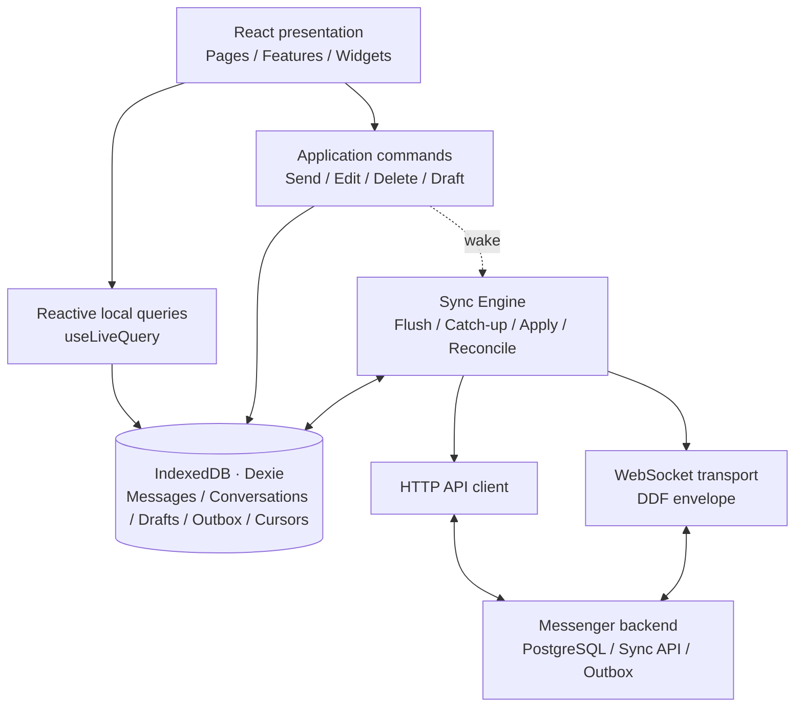
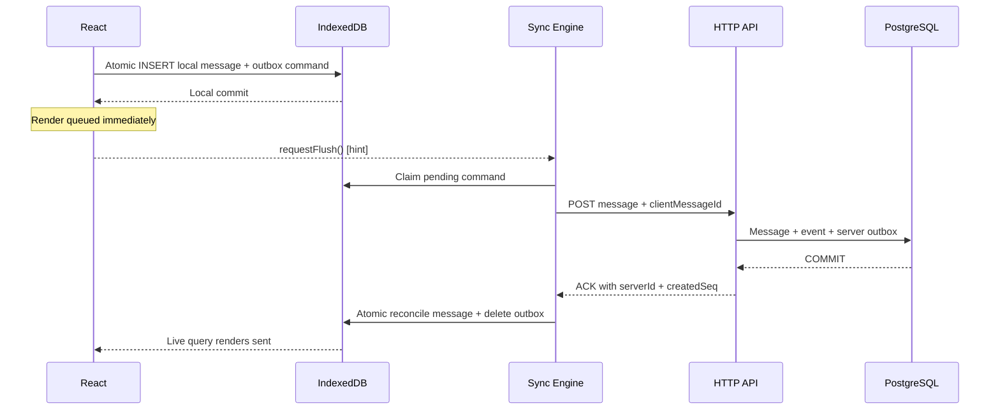

# DIO Messenger — Frontend Architecture (MVP)

> **Статус:** проектное решение для реализации качественного MVP · 2026-11-23  
> **Корень frontend-проекта:** `messenger.web/`  
> **Связанные документы:** [ARCHITECTURE](ARCHITECTURE.md) · [CODE_STANDARDS](CODE_STANDARDS.md) · [FRONTEND_CODE_STANDARDS](FRONTEND_CODE_STANDARDS.md) · [ADR-0002](adr/ADR-0002-http-websocket-and-sync.md) · [ADR-0004](adr/ADR-0004-offline-first-client.md) · [ADR-0005](adr/ADR-0005-tenancy-and-security.md)
>
> **Назначение:** описать, *из каких частей состоит клиент Messenger, как они взаимодействуют и почему offline-first работает*. Это не готовая реализация и не утверждённая OpenAPI/WS-спецификация. Примеры контрактов далее иллюстративны: при реализации сверять с актуальным backend и DDF Realtime.

## 1. Цели и ограничения MVP

DIO Messenger — коммуникационная часть DIO Desk и потенциально самостоятельный продукт экосистемы DIOS. MVP может иметь упрощённый набор функций, но не должен иметь упрощённые гарантии целостности, авторизации и синхронизации.

**Пользовательские цели:**

- Быстро открыть интерфейс и увидеть уже загруженные переписки, даже без сети.
- Создать и **локально сохранить** сообщение при отсутствии сети; автоматически отправить после её восстановления, если приложение работает.
- Не получить дубли после повтора запроса, потери HTTP ACK или получения WS-события до ACK.
- Корректно восстановить изменения после reconnect: новые сообщения, edit/delete, reactions, membership и другие долговременные события.
- Поддерживать несколько вкладок и несколько устройств без расхождения серверного состояния.
- Видеть корректные права, разделение внутренних и гостевых бесед, статусы отправки и недоступность операций.
- Работать с вложениями, превью, упоминаниями, поиском, контекстными карточками DIO Desk.

**Технические инварианты:**

1. **Backend PostgreSQL — авторитетное состояние.** IndexedDB — локальная реплика/проекция плюс неподтверждённые клиентские команды.
2. **Интерфейс читает локальное durable-состояние из IndexedDB.** Сеть обновляет локальное хранилище; React не обязан быть online для отображения кеша.
3. **Любая pending команда переживает reload**, если браузер сохранил IndexedDB: локальная запись сообщения и запись Outbox создаются атомарно.
4. **WebSocket — канал уведомлений, не источник истины.** Потерянные events восполняются через HTTP Sync API.
5. **Server ACK `sent` — commit в backend PostgreSQL**, а не только приём пакета или постановка в RabbitMQ.
6. **At-least-once на сетевых границах, идемпотентный эффект.** Повторные HTTP команды и WS events допустимы.
7. **Нельзя терять события из-за курсора:** данные и непрерывно подтверждённый cursor фиксируются в *одной* IndexedDB-транзакции.
8. **Безопасность не выводится из UI:** каждый backend-запрос проверяет аутентификацию, membership, tenant scope и policy.
9. **Offline-first не означает вечный offline-доступ:** политики локального хранения, отзыв прав и возможности браузера ограничивают гарантии.

Целевые SLO из [ARCHITECTURE](ARCHITECTURE.md): send → ACK p95 < 150–200 ms; online delivery p95 < 300–500 ms; открытие беседы из кеша < 100 ms perceived; reconnect < 2 s в целевых условиях. Метрики подлежат измерению на стендах и не являются обещанием до тестирования.

## 2. Технологический стек и ответственность инструментов

| Назначение | Выбор | Почему / граница |
|---|---|---|
| SPA | **React + TypeScript + Vite** | Авторизованный realtime UI, SSR истории не требуется |
| Monorepo | **pnpm workspaces** | Переиспользуемый core и UI для standalone/embedded |
| Routing | **React Router** | Маршруты standalone-приложения, lazy routes |
| Локальная БД | **IndexedDB + Dexie** | Транзакции, индексы, migrations, реактивное чтение |
| React подписки на БД | **dexie-react-hooks** (`useLiveQuery`) | Изменение БД → перерисовка нужных компонентов |
| HTTP server-state | **TanStack Query** | Поиск, разрешённые previews, HTTP query lifecycle; *не* история сообщений |
| UI-only state | **Zustand** + React state | Панели, выбор, модалки, фильтры отображения |
| Realtime | **Native WebSocket** + типизированный DDF client adapter | Одно соединение на runtime/вкладку до оптимизации |
| Длинные списки | **TanStack Virtual** | Windowing, динамическая высота, scroll anchoring |
| Offline app shell | **vite-plugin-pwa + Workbox** | Static assets, shell, offline route fallback |
| UI primitives | **Radix Primitives** (точечно) | Доступные диалоги, popovers, menus без навязанной темы |
| Стили | **CSS Modules + CSS variables** | Контроль UI, дизайн-токены DIOS, light/dark |
| Даты/числа | **Intl**; `date-fns` по необходимости | Локализация, даты и относительное время |
| Тесты | **Vitest, Testing Library, MSW, Playwright** | Unit/integration/component/E2E |
| Качество | **ESLint, typescript-eslint, Prettier, tsc** | Типы, стиль, CI |

**Не ставить без задачи:** Redux, RxJS, XState, CRDT, второй state-manager, собственный ORM для IndexedDB, WebRTC, canvas-рендерер сообщений, серверный SSR для auth-переписок. Их можно оценить позже по требованиям/метрикам.

Официальные справочники: [Dexie useLiveQuery](https://dexie.org/docs/dexie-react-hooks/useLiveQuery%28%29), [TanStack Query mutations](https://tanstack.com/query/latest/docs/framework/react/guides/mutations), [Web Locks API](https://developer.mozilla.org/en-US/docs/Web/API/Web_Locks_API), [Vite PWA](https://vite-pwa-org.netlify.app/), [Background Sync](https://developer.mozilla.org/en-US/docs/Web/API/Background_Synchronization_API).

## 3. Принцип устройства клиента



### 3.1. Границы слоёв

- **Presentation:** React, UI components, screens, hooks представления. Вызывает application-команды, читает live query. Не делает retry, reconciliation и ручное управление cursor.
- **Application:** высокоуровневые операции пользователя, локальные бизнес-правила UI, создание Outbox-заданий, согласование server ACK, Sync Engine. Преимущественно функции; Stateful lifecycle objects допустимы.
- **Data access:** Dexie schema/queries/migrations, HTTP client, WebSocket transport, media uploader, auth adapter. Внешние данные валидируются/нормализуются на этой границе.
- **Server:** API/Sync/WS с поддержкой идемпотентности, последовательности событий и ACL. Frontend *не пытается* заменить backend-проверки.

**Правило:** React-компонент знает команду `sendMessage`, но не знает, какие HTTP retries или WS resubscriptions потребуются для её успешного исполнения.

## 4. Структура репозитория `messenger.web/`

Для MVP — **2 shared packages + 1 app**. Это monorepo по назначению, а не десятки внутренних npm-пакетов ради организации папок.

```text
messenger.web/
├── apps/
│   └── messenger/
│       ├── public/
│       ├── src/
│       │   ├── app/
│       │   │   ├── providers/       # auth adapter, runtime, query client, theme
│       │   │   ├── router/          # React Router, protected routes
│       │   │   ├── layouts/
│       │   │   └── bootstrap.ts     # composition root
│       │   ├── pages/
│       │   │   ├── messenger/
│       │   │   └── conversation/
│       │   ├── widgets/
│       │   │   ├── conversation-list/
│       │   │   ├── message-timeline/
│       │   │   ├── chat-header/
│       │   │   └── chat-sidebar/
│       │   ├── features/
│       │   │   ├── conversations/
│       │   │   ├── messaging/
│       │   │   ├── composer/
│       │   │   ├── attachments/
│       │   │   ├── mentions/
│       │   │   ├── search/
│       │   │   ├── participants/
│       │   │   └── settings/
│       │   ├── shared/           # маленькие app-specific helpers
│       │   └── main.tsx
│       ├── index.html
│       ├── vite.config.ts
│       └── package.json
├── packages/
│   ├── messenger-core/
│   │   ├── src/
│   │   │   ├── models/          # types + normalized models
│   │   │   ├── commands/        # send/edit/delete, drafts
│   │   │   ├── storage/         # Dexie db, repositories, versions
│   │   │   ├── outbox/          # local outbox processor
│   │   │   ├── sync/            # sync engine, replay, cursors
│   │   │   ├── transport/       # http / websocket + auth contracts
│   │   │   ├── media/           # upload/download coordination
│   │   │   └── index.ts
│   │   ├── package.json
│   │   └── tsconfig.json
│   └── messenger-ui/
│       ├── src/
│       │   ├── primitives/
│       │   ├── components/
│       │   ├── hooks/
│       │   ├── tokens/
│       │   └── styles/
│       ├── package.json
│       └── tsconfig.json
├── docs/                       # frontend-local notes (если понадобятся)
├── package.json
├── pnpm-workspace.yaml
├── tsconfig.base.json
├── eslint.config.js
└── prettier.config.js
```

Это **структура frontend-репозитория**. Основные системные документы `FRONTEND_ARCHITECTURE.md` и `FRONTEND_CODE_STANDARDS.md` живут в корневом `docs/` документации Messenger, рядом с backend ADR. Не дублировать нормативную документацию при каждом build.

### 4.1. Ответственность пакетов

- **`messenger-core`**: независимые от React протоколы, модели, IndexedDB, Sync Engine, local Outbox, API/WS клиент, media coordination; exports — узкие публичные API. Для Dexie-адаптера допустима зависимость от browser runtime, но чистые алгоритмы sync нужно тестировать изолированно.
- **`messenger-ui`**: визуальная система (типографика, цвета, темы, атомарные компоненты, accessibility, композиция bubble); без API-запросов и доступа к БД. UI может принимать типизированные view models через props.
- **`apps/messenger`**: маршруты, экраны, конкретные features, composition root, конфигурация DIO Desk auth и mounting. UI features организованы по пользовательским задачам, а не по видам классов.

Для небольшой feature допустимо 2–3 файла в одном каталоге; не создавать обязательные `model/api/ui/lib` каталоги без причины. Когда появляются другие приложения (например, отдельная оболочка для DIO Desk), выносить общую функциональность постепенно.

### 4.2. Пример feature

```text
features/messaging/
├── components/
│   ├── MessageBubble.tsx
│   ├── MessageStatus.tsx
│   ├── MessageContent.tsx
│   └── MessageActions.tsx
├── hooks/
│   └── useMessages.ts
├── model/
│   └── toMessageViewModel.ts
└── index.ts
```

## 5. State ownership: один владелец у каждого типа состояния

| Данные | Владение | Важное ограничение |
|---|---|---|
| Сообщения, беседы, memberships, read cursors | **IndexedDB** | Durable local projection; сервер авторитетен |
| Черновики, pending uploads, local Outbox | **IndexedDB** | Атомарные write-транзакции; backend может ещё не знать |
| Sync cursors, page boundaries, sync checkpoints | **IndexedDB** | Согласованность с применёнными events |
| Поиск, previews внешних объектов, lookup | **TanStack Query** | Это сетевые запросы; offline UX явно ограничен |
| Открытые меню, панели, выбранный чат, ephemeral selection | **Zustand / React** | Не зеркалировать туда историю сообщений |
| Typing, transient presence, socket connectivity | **In-memory runtime** | Не обязательно хранить в БД, TTL/expiry |
| JS, CSS, шрифты, app shell | **Service Worker Cache Storage** | Не переносить туда приватный API cache автоматически |

**Не делать двойную копию messages как authoritative в TanStack Query и Zustand.** HTTP-батчи истории и WS delta проходят через нормализацию и попадают в IndexedDB; React получает локальную проекцию через `useLiveQuery`. TanStack Query продолжает быть полезен для запросов, где долговременная локальная реплика не нужна.

## 6. Индексированная локальная база данных

### 6.1. Логические таблицы

```text
IndexedDB / Dexie
├── conversations      # authorised locally visible conversations
├── messages           # canonical + optimistic messages
├── outbox             # durable commands awaiting reconciliation
├── drafts             # locally persisted composer state
├── sync_cursors       # per-conversation continuous applied cursor
├── memberships        # projection of role, joined/left, permissions
├── media_metadata     # asset/variant status, dimensions, safe metadata
├── upload_sessions    # recoverable upload state (not bytes by default)
└── preferences        # local UI settings
```

**Scope:** каждая запись должна иметь `accountKey` или храниться в отдельной БД на идентичность пользователя/организации. `accountKey` формируется из **подтверждённого** контекста DIO Desk, а не из пользовательских параметров или legacy `_STUB_ORGANIZATION_ID`. Если старый DIO Desk не отдаёт проверенный tenant, это отдельный blocker для guest/multi-tenant scenario; не симулировать изоляцию заглушкой.

### 6.2. Идентичность сообщения

| Поле | Смысл |
|---|---|
| `localId` | Стабильный PK IndexedDB и `key` React-компонента; не меняется после ACK |
| `clientMessageId` | Уникальный идентификатор идемпотентной команды Send; сохраняется при retry |
| `serverId` | UUID канонического server message, может отсутствовать до ACK |
| `createdSeq` | Позиция **создания** сообщения в беседе, не меняется при edit/delete |
| `revision` | Серверная ревизия сообщения для оптимистичной конкурентной проверки |
| `deliveryState` | Клиентское представление queued / sending / sent / retrying / failed |

`createdSeq`/`eventSeq` на backend — PostgreSQL `BIGINT`. Для JS нужно явно согласовать формат. **Для MVP можно требовать JSON safe integers и проверять верхнюю границу на сервере** (по беседе это практически неограниченный горизонт); альтернатива — opaque string cursor и сравнение только на сервере. Нельзя молча парсить потенциально произвольный `BIGINT` в неточный JS `number`.

### 6.3. Упрощённая схема Dexie

```ts
import Dexie, { type Table } from "dexie";

type DeliveryState = "queued" | "sending" | "sent" | "retrying" | "failed";

interface LocalMessage {
  localId: string;
  accountKey: string;
  conversationId: string;
  clientMessageId: string;
  serverId?: string;
  createdSeq?: number;
  revision?: number;
  content: MessageContent;
  deliveryState: DeliveryState;
}

interface OutboxItem {
  id: string;
  accountKey: string;
  conversationId: string;
  type: "message.send";
  command: SendMessageCommand;
  state: "pending" | "processing" | "retrying" | "failed";
  attempts: number;
  nextAttemptAt: number;
}

class MessengerDatabase extends Dexie {
  messages!: Table<LocalMessage, string>;
  outbox!: Table<OutboxItem, string>;

  constructor() {
    super("dio-messenger");
    this.version(1).stores({
      messages: "&localId, [accountKey+conversationId], &[accountKey+clientMessageId], [accountKey+conversationId+createdSeq]",
      outbox: "&id, [accountKey+state], [accountKey+nextAttemptAt]",
    });
  }
}
```

Это пример минимального набора полей: реальная версия включает `conversations`, `drafts`, `sync_cursors`, индексы для нескольких направлений pagination и миграции. **Индексы, DTO и локальные модели не должны автоматически совпадать 1:1.** При `createdSeq` отсутствующем у pending-message сортировка выводится в отдельном timeline selector с локальным order key.

При изменении schema increment Dexie version и написать **проверяемую миграцию**. Никогда не делать `db.delete()` как нормальный способ миграции в production: это удалит неотправленные сообщения.

### 6.4. Live queries и pagination

```ts
import { useLiveQuery } from "dexie-react-hooks";

function useRecentMessages(
  db: MessengerDatabase,
  accountKey: string,
  conversationId: string,
) {
  return useLiveQuery(
    () =>
      db.messages
        .where("[accountKey+conversationId+createdSeq]")
        .between(
          [accountKey, conversationId, 0],
          [accountKey, conversationId, Number.MAX_SAFE_INTEGER],
        )
        .reverse()
        .limit(50)
        .toArray(),
    [db, accountKey, conversationId],
    [],
  );
}
```

Это только подтверждённые server-sequenced сообщения; локальные queued сообщения надо дополнить отдельным небольшим запросом и объединить в presentation selector. Не загружать и не рендерить всю историю беседы при каждом изменении. `TanStack Virtual` управляет windowing, а БД и HTTP API — page ranges.

## 7. Local Outbox: запись сообщений без сети

**Не путать:** Client Outbox в IndexedDB и Server Transactional Outbox в PostgreSQL — два разных механизма с разными задачами.

- **Client Outbox:** сохраняет пользовательскую команду до подтверждения server commit, переживает reload и повторяет отправку.
- **Server Outbox:** атомарно с message/event сохраняет событие для RabbitMQ/realtime. Схема LISTEN/NOTIFY + polling остаётся на backend и *не влияет* на клиентский ACK после DB commit.

### 7.1. Pipeline отправки



### 7.2. Application-функция

```ts
export async function sendMessage(
  command: SendMessageCommand,
  deps: { db: MessengerDatabase; accountKey: string; sync: SyncWakeup },
): Promise<void> {
  const clientMessageId = crypto.randomUUID();

  await deps.db.transaction(
    "rw",
    deps.db.messages,
    deps.db.outbox,
    async () => {
      await deps.db.messages.add({
        localId: clientMessageId,
        accountKey: deps.accountKey,
        conversationId: command.conversationId,
        clientMessageId,
        content: command.content,
        deliveryState: "queued",
      });
      await deps.db.outbox.add({
        id: clientMessageId,
        accountKey: deps.accountKey,
        conversationId: command.conversationId,
        type: "message.send",
        command: { ...command, clientMessageId },
        state: "pending",
        attempts: 0,
        nextAttemptAt: 0,
      });
    },
  );

  deps.sync.requestFlush(); // hint, durable command already exists
}
```

`SendMessageCommand` — typed application command с `conversationId`, `content` и `clientMessageId?: string` для подготовленного network payload. В production предпочтительно разделить command до отправки и wire payload на два типа, чтобы `clientMessageId` всегда был обязательным на HTTP-границе. Пример подчёркивает транзакционный принцип, не полную типовую систему.

**Нельзя делать `fetch()` внутри Dexie transaction.** Сетевая операция проходит *после* локального commit. Длительная await-операция вне IndexedDB API может завершить транзакцию раньше времени.

### 7.3. Исполнитель Outbox

Алгоритм:

1. Найти due `pending`/`retrying` операции текущего `accountKey`.
2. Взять локальный exclusive claim/lock на отправку (особенно при нескольких вкладках).
3. Пометить in-flight и вызвать HTTP вне транзакции IndexedDB.
4. При ACK атомарно найти локальную запись по `clientMessageId`, проставить `serverId`, `createdSeq`, revision и удалить операцию.
5. На timeout/разрыв сети оставить **тот же** `clientMessageId`, назначить backoff + jitter, повторить при следующей попытке.
6. На авторизационный отказ — stop/re-auth, без слепого retry; на policy error — terminal failed с понятным действием пользователя.
7. При startup операции, оставшиеся `processing` после crash, вернуть в retryable state; использовать lease/timeout, а не бесконечный `processing`.

Backend обязан иметь idempotency constraint/lookup и возвращать тот же канонический результат при повторе; при совпадении ключа, но различающемся содержимом — явный конфликт. HTTP response и WS echo могут прийти в любом порядке и должны сходиться к **одной** локальной записи.

### 7.4. Таблица состояний

| Статус | Значение | UI |
|---|---|---|
| `queued` | Локально сохранено, сервер не подтверждал | Часы / «Ожидает сети» |
| `sending` | Выполняется попытка | Ненавязчивый индикатор |
| `sent` | Подтверждён PostgreSQL commit | Одна галочка / «Отправлено» |
| `retrying` | Исход попытки неизвестен или временная ошибка | «Повторная отправка» |
| `failed` | Неустранимая ошибка/требуется действие | Retry/Edit/Remove |

`delivered`/`read` — **не те же самые статусы локальной отправки**. Для direct/group они вычисляются по receipt-состоянию участников и не должны смешиваться с lifecycle локальной команды.

## 8. Sync Engine: протокол согласованности

Sync Engine — **долгоживущий объект с lifecycle** (`start/stop`), не React hook с набором `useEffect` и таймеров. Алгоритмы применения и reconcile — простые функции, если возможно. Он работает по одному подтверждённому `accountKey` и пересоздаётся при смене пользователя/организации.

```ts
export interface SyncEngine {
  start(): Promise<void>;
  stop(): Promise<void>;
  requestFlush(): void;
  synchronize(): Promise<void>;
  getStatus(): SyncStatus;
  subscribe(listener: (status: SyncStatus) => void): () => void;
}
```

### 8.1. Bootstrap

1. Получить **проверенный** auth context из DIO Desk, выбрать локальный scope.
2. Открыть Dexie и применить versioned migrations.
3. Отобразить локальные conversations/messages **до** запроса API. Если offline-доступ запрещён policy — сначала потребовать online validation.
4. Запустить Sync Engine: транспорт WS + подписки на `user`/активные conversation rooms через DDF.
5. Организовать отсутствие «окна потери»: снимать последовательный snapshot/cursor и буферизовать live events на время catch-up (или использовать согласованный atomic snapshot-and-stream протокол backend).
6. Запросить `GET /v1/sync/manifest` (пример) для обнаружения новых/удалённых/изменённых бесед и scope changes.
7. Для изменённых conversations вызвать HTTP delta (`GET /v1/conversations/{id}/events?afterSeq=N`, пример), применить батчи с cursor.
8. Разобрать live buffer, дедуплицировать, применить только последовательные события.
9. Запустить Local Outbox flush и поддерживать периодический reconciliation/focus reconnect.

**Правильность при resume:** нельзя считать, что сама отправка WS subscribe и HTTP snapshot автоматически исключает гонку. Требуется серверно согласованный high-water mark, буферизация или повторный delta catch-up после подписки; сценарий проверяется E2E под конкурирующими записями.

### 8.2. События и cursor

Пример **прикладного payload** внутри существующего DDF `RealtimeEvent` envelope (не создавать второй несовместимый envelope):

```json
{
  "type": "message.edited",
  "payload": {
    "conversationId": "c31c4fb7-f48f-4fcb-bcde-df49fa4a6e44",
    "eventSeq": 105,
    "eventId": "f8adfd4a-38d0-4148-95f2-86a3b0e7c2d2",
    "messageId": "e153510d-f0ce-4535-9a14-c8d92ad090b9",
    "revision": 2
  }
}
```

`eventSeq` — последовательность изменений *внутри беседы*, отличная от `createdSeq`. Для `message.created` — новое сообщение, для `message.edited`/`deleted`/`reaction.added` — изменения прежнего сообщения. Проекция событий должна обеспечить понятную непрерывную последовательность **для авторизованного клиента**: если политика фильтрует событие, нужно явно определить redacted/no-op checkpoint или другой безопасный механизм advance cursor. Нельзя выводить «потерю сети» лишь из дырки, вызванной секретным серверным событием.

Применение события: проверить runtime schema/version → проверить scope → проверить дубликат → если `seq <= cursor`, ignore; если `seq == cursor + 1`, применить данные и обновить cursor в одной транзакции; если `seq > cursor + 1`, буферизовать + delta catch-up. Временные сетевые reorder/duplicates нормальны.

### 8.3. Почему нельзя sync только по `createdAt` или `createdSeq`

Пока клиент offline, пользователь B может изменить старое сообщение A, удалить сообщение C, добавить реакцию к D. `createdSeq` нового сообщения не покрывает изменения существующих. `updatedAt` не является надёжным безоговорочным порядком commit. Поэтому нужен server-created `ConversationEvent` + cursor и, при превышении retention, явный snapshot recovery.

### 8.4. Atomic apply

```ts
async function applyEvent(
  db: MessengerDatabase,
  accountKey: string,
  event: ConversationEvent,
): Promise<void> {
  await db.transaction(
    "rw",
    db.messages,
    db.syncCursors,
    async () => {
      const cursor = await db.syncCursors.get([
        accountKey,
        event.conversationId,
      ]);
      const last = cursor?.eventSeq ?? 0;

      if (event.eventSeq <= last) return;
      if (event.eventSeq !== last + 1) {
        throw new SyncGapError(last, event.eventSeq);
      }

      await applyEventProjection(db, accountKey, event); // same transaction
      await db.syncCursors.put({
        accountKey,
        conversationId: event.conversationId,
        eventSeq: event.eventSeq,
      });
    },
  );
}
```

Для полного реального кода список таблиц транзакции **обязан включать все таблицы**, в которые пишет `applyEventProjection()` (`conversations`, `messages`, `memberships`, `media_metadata`, etc.). Иначе Dexie не разрешит операции/они не будут атомарны. Пример подчёркивает атомарность, а не готовую реализацию.

### 8.5. Manifest, ACL и retention

`/sync/manifest` возвращает только авторизованные беседы и их high-water marks, список видимых conversation IDs и/или стабильный cursor списка. Нужна модель **removal/revocation**, чтобы клиент мог обнаружить, что беседа больше не доступна, даже если он не получил WS event об исключении.

Если `afterSeq` старше retention, backend возвращает явный `resync_required`/`snapshot_required`, после чего клиент безопасно пересобирает проекцию и cursor. **Нельзя просто пропустить историю и присвоить новый seq**, не восстановив текущее состояние сообщений, реакций, pins, memberships и прав. Нужно фиксировать границы истории для приглашённых участников и ограничения доступа к старым сообщениям.

### 8.6. Conflict policy для MVP

| Операция | Правило |
|---|---|
| Send | Идемпотентно по `clientMessageId`; сервер назначает `createdSeq` |
| Edit | Server authoritative `revision`, конфликт при несовпадении `expectedRevision` |
| Delete | Серверный tombstone побеждает локальную копию, retention соблюдается |
| Reactions | Идемпотентные add/remove, server-authoritative результат |
| Read cursor | Только монотонное движение, per membership |
| Local drafts | Локальный владелец в MVP; кросс-девайс синхронизация отдельно |
| Conversation policy / membership | Server authoritative, может сделать pending command невалидной |
| Upload | Состояние upload session + MediaAsset READY с сервера |

**CRDT/automatic merge не нужны для MVP.** Бизнесовые конфликты должны быть явными и понятными для UI, а не скрываться за случайным last-write-wins.

### 8.7. Retry и network status

- `navigator.onLine` — **подсказка**, не доказательство доступности API; фактический сигнал — результат HTTP/WS health.
- Retryable: network failure, timeout, временные 5xx, 429 с `Retry-After`; exponential backoff + jitter, bounded concurrency.
- Не retryable без изменения: permission denied, invalid content, revoked conversation, policy violation.
- При 401 — остановить flush и запросить обновление сессии через DIO Desk auth adapter.
- При reconnect, focus/visibility change и startup — выполнять reconciliation; WS reconnect сам по себе не доказывает полноту локального состояния.
- При многочасовом offline не хранить бесконечный in-memory buffer: восстановление через HTTP.

## 9. Несколько вкладок, устройств и origin boundaries

**Один origin:** IndexedDB общая для вкладок данного origin; Dexie live queries реагируют на изменения из соседних вкладок. **Разные origin:** нельзя совместно использовать IndexedDB между `desk.example` и `messenger.example`; переиспользуется код, а данные синхронизируются с backend по отдельности.

### MVP policy

- **Правильность сначала:** у каждой вкладки может быть свой WebSocket, но Local Outbox должен иметь координацию или надёжные server idempotency keys. Не рассчитывать на «обычно вкладка одна».
- Лучше применить `navigator.locks.request()` к flush/claim одного `accountKey` (feature detection + fallback), либо реализовать транзакционный lease с expiry в IndexedDB. Web Locks координируют **только окна одного origin**, а не устройства.
- `BroadcastChannel` подходит для сигналов `wake`/`syncNow`, не для authoritative delivery. Dexie уже распространяет изменения БД в пределах origin.
- При восстановлении вкладки `processing` jobs с истёкшим lease повторяются с исходным idempotency key.

**Оптимизация позже:** leader tab держит один WebSocket, другие получают события через Dexie/BroadcastChannel. Добавлять после проверки сложности/нагрузки. На разных устройствах shared lock невозможен и не нужен: согласованность обеспечивает backend.

## 10. Service Worker и PWA

Разделяем ответственности:

- **Service Worker** → доступность *кода приложения* без сети: precached app shell, JS/CSS, шрифты, fallback route.
- **IndexedDB** → доступность *данных пользователя* и local commands.
- **Sync Engine** → согласование *сообщений и состояния* с сервером.

Для MVP можно начать с `vite-plugin-pwa` strategy `generateSW`; переходить к `injectManifest`, когда действительно нужны нестандартные SW operations. Не создавать второй механизм Outbox в SW и window без координации.

| Resource | PWA policy |
|---|---|
| Hashed JS/CSS/fonts/icons | Precache |
| Navigation/SPA shell | Offline fallback |
| Authenticated JSON responses | **Не** кешировать универсальными SW правилами |
| Message history | IndexedDB |
| Drafts / Outbox | IndexedDB |
| Small authorised thumbnails | Limited, scoped client cache |
| Original attachments | On demand, policy-controlled |
| Presigned S3/CDN URL | Ephemeral; never durable history field |

**Работа в фоне при закрытом приложении:** Background Sync в браузере не является универсальной гарантией отправки. В MVP гарантируем автоматический retry **пока приложение работает** и **после следующего открытия**. Закрытое приложение может не отправлять pending messages до нового запуска.

**Storage reliability:** IndexedDB может быть очищена пользователем/браузером/политикой устройства. Можно запросить `navigator.storage.persist()` при оправданной необходимости, мониторить quota (`StorageManager.estimate()`), но нельзя объявлять браузерное хранилище абсолютной durable гарантий. Для критичных корпоративных данных продумать политику локального retention.

## 11. Chat UI/UX и производительность

### 11.1. Timeline

- Виртуализация **TanStack Virtual**; показывать только видимые элементы + небольшой overscan.
- Пагинация истории — keyset на backend (`beforeSeq`), IndexedDB хранит известные диапазоны/границы, подгружает при scroll.
- При загрузке старых сообщений сверху **сохранять scroll anchor**, не проскролливать вниз.
- При появлении новых сообщений, если пользователь читает старое, показывать `N новых`, а не принудительную прокрутку.
- Не заменять локальные сообщения skeleton'ами при каждом refetch; skeleton — только при реальном отсутствии локальной проекции.
- Изображения/видео заранее резервируют место по known dimensions/aspect ratio, чтобы не было layout jumps.
- `localId` — стабильный React `key`, `serverId` меняется только как поле данных.

### 11.2. Composer и drafts

- Enter / Shift+Enter; корректная поддержка IME/composition, selection/caret.
- Paste image из clipboard, drag & drop, reply, mentions, attachments, доступные keyboard shortcuts.
- Сохранять draft локально (debounce + flush при важном lifecycle event), поддерживать локальный список pending attachments.
- UI не должен считать кнопку Send синхронным сетевым действием; сначала durable local write, потом асинхронный flush.
- При `failed` предлагать retry/edit/remove без скрытой потери текста.

### 11.3. Status, presence, receipts

- Typing/presence — ephemeral in-memory с TTL, rate limit на отправку `typing` и отдельная обработка reconnect.
- Sent/Delivered/Read — разные семантики. В группах прочтение/доставка per-member, не один Boolean.
- Unread badge — серверно согласованные cursors; локальная проекция может показывать optimistic unread, но не скрывать authority backend.

### 11.4. UX при ошибках

- Состояния `offline`, `reconnecting`, `syncing`, `outdated`, `conflict`, `action_required` должны быть различимы.
- Нет бесконечного spinner без объяснения; при временном offline история остаётся читаемой согласно policy.
- Для недоступного чата показывать понятный экран `access revoked`, одновременно останавливая доступ к локальному контенту и выполняя cleanup по политике.

## 12. Вложения, аватары и offline media

Backend хранит `MediaAsset` и его варианты, файловые байты идут **direct S3** через presigned upload/download. Frontend знает только `assetId`, вариант и срок действия временного URL. CDN — возможный будущий адаптер выдачи ссылок, не зависимость в коде UI.

### 12.1. Клиентский pipeline

```text
Select file -> local preview -> create upload session via HTTP
   -> direct S3 upload + progress -> finalize upload
   -> await MediaAsset READY -> attach assetId to message content
   -> local send message + Outbox -> backend commit
```

- `AttachmentDraft` — frontend-модель незавершённого вложения; не добавлять S3 URLs и всякие `imageWidth?` в `Message`.
- Рендер блока по discriminated union: `TextBlock`, `MediaBlock`, `ResourceBlock`; media file metadata — отдельная нормализованная запись.
- Worker-статусы (`PENDING`, `PROCESSING`, `READY`, `REJECTED`) приходят с backend, UI-статусы (`uploading`, `paused`, `retrying`) локальные.
- Короткоживущие presigned URLs нельзя писать в persistent Message/IndexedDB как каноническое поле. Проверка ACL выполняется на backend **при каждой выдаче URL**.
- Small blobs можно сохранять в IndexedDB только с quota budget; для крупных файлов обещание resume после reload недопустимо без доступного локального `File`/handle и соответствующего браузерного разрешения.
- Preview/thumbnail кэш ограничивать по объёму, сроку и tenant policy. Запретить автоматическое кеширование закрытых оригиналов.
- Аватары группы: `custom` → `generated lettermark` или `member collage` в зависимости от сценария; frontend применяет стабильный fallback. Пользовательские аватары — из DIO Desk, group custom — из Messenger.

### 12.2. Компоненты вложенного контента

```text
features/messaging/components/
  MessageContent.tsx
  TextBlock.tsx
  MediaBlock.tsx
  ResourceBlock.tsx
  media/
    ImagePreview.tsx
    VideoPreview.tsx
    AudioPlayer.tsx
    FileAttachment.tsx
```

Никаких HTML-строк, подставляемых через `dangerouslySetInnerHTML`, для пользовательских сообщений. Разрешённый rich text — типизированный AST/ограниченный renderer с безопасной обработкой ссылок и текста.

## 13. DIO Desk authentication и embedding

**Текущий источник аутентификации — Legacy DIO Desk, не новая DIOS IAM.** Frontend получает подтверждённый auth context через adapter от хост-приложения/существующего потока входа. Не копировать `_STUB_ORGANIZATION_ID` из KB как реальный tenant scope.

```ts
export interface MessengerAuthAdapter {
  getContext(): Promise<MessengerAuthContext>;
  getAccessToken(): Promise<string>;
  refresh(): Promise<void>;
  subscribe(listener: () => void): () => void;
}
```

Адаптер скрывает детали текущей схемы авторизации (token injection, refresh, logout). **Токены доступа не хранятся в IndexedDB или LocalStorage по умолчанию**; на web предпочтительны защищённые cookie/BFF при доступности такой схемы либо короткоживущие access tokens в памяти и host-managed refresh.

**WebSocket в браузере:** нативный `WebSocket` не поддерживает произвольный `Authorization` header как `fetch`. Предпочесть same-site secure cookie либо отдельный короткоживущий одноразовый WS ticket, полученный по авторизованному HTTP; валидировать `Origin`, scope и подписки. Не передавать долгоживущий Bearer token в URL WebSocket.

**Режимы:**

- **Standalone:** `messenger.web/apps/messenger` как обычное React SPA с собственными route/layout.
- **Embedded в DIO Desk:** UI/core подстраиваются под host контекст, тему, routing и навигацию. Можно использовать React packages, mount адаптер или изолированную интеграцию по согласованному protocol.
- **Разные origins:** IndexedDB не общая; каждый клиент создаёт отдельную локальную реплику и синхронизирует её с сервером.

Интеграция с ITSM — через безопасные resource previews/actions и API. UI-карточка инцидента не расширяет права доступа к инциденту. Внешние участники видят security boundary беседы, а карточки с недоступными полями — redacted.

## 14. Multi-tenant, privacy, security и revocation

- Изолировать cache и Outbox по **проверенному** пользователю/организации (или отдельная БД на account). При смене identity закрывать Sync Engine, WebSocket, media transfers, очищать ephemeral memory и закрывать доступ к старой проекции.
- Logout — очистка локальных данных **по политике**; нужно обрабатывать случай частичного отказа очистки и cache/SW состояния. Не хранить приватный контент в публичном SW precache.
- При revocation сервер запрещает новые запросы/подписки; клиент purge/restrict локальный cache после получения уведомления или reconciliation. **При offline revocation не может быть мгновенной** без онлайн-проверки/управляемого устройства: это фиксируется как продуктовый trade-off.
- Для особо чувствительных бесед — deny offline cache, короткий offline lease, обязательная online revalidation или управляемая корпоративная политика. «Всегда offline» и «мгновенно отозвать уже скачанное» несовместимы.
- Не логировать текст/медиа, access tokens и presigned URLs. Ошибки и telemetry — redacted metadata, correlationId, eventId, timings, безопасные counters.
- XSS, DOM injection, untrusted Markdown, media MIME, dangerous URLs — отдельные security tests.
- Если нужен шифрованный local store, модель ключей должна быть реальной; шифрование ключом, лежащим рядом с данными в браузере, не обеспечивает meaningful access control.

## 15. Тестирование и observability

### 15.1. Unit/integration/component/E2E

| Уровень | Что проверяем |
|---|---|
| Unit · Vitest | merge/reconcile, reducer событий, ordering, conflict, status mapping, retry policy |
| Integration · Vitest + fake-indexeddb + MSW | Транзакции Dexie, Outbox restart, HTTP failures, sync cursor, migrations |
| Component · Testing Library | Composer, message bubbles, virtualized timeline в тестируемых сценариях, a11y |
| E2E · Playwright + test backend | Offline/reload, lost ACK, WS before HTTP, gap recovery, multi-tab, guest ACL, media |
| Performance | First meaningful cached render, scroll FPS, memory, WS events/sec, local DB size |

**Обязательные E2E сценарии:**

1. Offline send → reload → reconnect → ровно одно серверное сообщение.
2. Server commit + потерянный HTTP ACK → retry с тем же key → отсутствие дубликата.
3. WS echo пришёл до ACK → одна локальная bubble, стабильный `localId`.
4. Events 104, 106 при отсутствии 105 → catch-up, cursor не перескакивает.
5. Превышен retention → корректный snapshot recovery вместо silent skip.
6. Вторая вкладка пытается отправить ту же локальную команду → idempotent result.
7. Membership revoked → сервер запрещает read, клиент purge/restrict кеш после sync.
8. Scroll назад + загрузка старых сообщений → anchor остаётся стабильным.
9. Отправка вложения, обрыв upload, repeat/abort → нет нарушений READY/ACL.
10. Обновление PWA version с pending Outbox → данные сохраняются после миграции.

### 15.2. Metrics

Собирать без контента сообщений: local write latency, time-to-render-cached-chat, Outbox backlog count/age, HTTP request latency, sync catch-up time, gap recoveries, WS reconnect count, event apply duration, Dexie migration failure, failed upload count. Производительность строится вокруг реальных client timings (Web Vitals + domain-specific marks), а не только серверных p95.

## 16. Порядок реализации

1. **Foundation:** `messenger.web`, pnpm/Vite, strict TS, routing, tokens, AuthAdapter, Dexie schema + migrations, минимальные bubble/composer.
2. **Local durable commands:** save Message+Outbox в одной транзакции, отображение queued и восстановление после reload.
3. **Backend connectivity:** typed HTTP client, legacy DIO Desk auth, send ACK reconciliation, idempotency, retries.
4. **Sync:** DDF WebSocket adapter, initial manifest, delta events, gaps, retention recovery, multi-tab coordination.
5. **Production UX:** TanStack Virtual, scroll anchor, reactions/replies/mentions, drafts, receipts, search, accessibility.
6. **Media + enterprise:** direct S3 upload/download, processing feedback, guest restrictions, conversation policies, avatars, ITSM previews.
7. **Hardening:** PWA shell, cache/privacy policies, fault injection, multi-device E2E, performance profiling, release gates.

Этапы не запрещают параллельную работу над дизайном, но интегрированный chat UI **должен сразу опираться на локальное хранилище**, а не на временный React-only кеш, который потом придётся переписывать.

## 17. Открытые контракты до активной реализации

Следующее требуется согласовать с backend (не считать утверждённым только из-за примеров в документе):

- Форма `GET /sync/manifest`, протокол авторизованного списка бесед и отзывов доступа.
- Механизм непрерывного клиентского event seq при ACL-filtered events, snapshot+subscription race.
- Retention событий и семантика `snapshot_required`.
- Формат больших cursor значений (`safe integer` vs opaque string).
- Visibility history при приглашении в беседу и поведение offline cache при membership revoke.
- Семантика group delivered/read; read cursor per member/device.
- Политика offline cache по организациям/гостевым беседам и поведение при logout.
- Предпочтительный auth transport для WS с текущим Legacy DIO Desk.
- Требования к CDN, загрузке больших файлов и их offline resume.

**Ключевой вывод:** Offline-first — это не PWA-флажок. Это согласованная архитектура: **IndexedDB как локальная проекция + транзакционный Client Outbox + независимый Sync Engine + идемпотентный backend с durable event cursor**. Всё остальное — интерфейс поверх этих гарантий.
