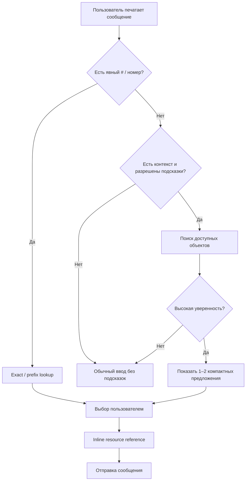

# DIO Messenger — UI/UX Design Specification

> **Статус:** концепция и требования к дизайну MVP · **Версия:** 1.0  
> **Дата:** 2026-11-23  
> **Расположение в репозитории:** `docs/design/UI_UX_DESIGN.md`  
> **Связанные документы:** `docs/architecture/ARCHITECTURE.md`, `docs/development/CODE_STANDARDS.md`, `docs/development/IMPLEMENTATION_PLAN.md`, `docs/development/TEST_PLAN.md`.

## 1. Назначение документа

Документ фиксирует согласованное направление UI/UX DIO Messenger: привычная коммуникация в духе Telegram, сдержанный современный визуальный язык DIOS, контекстные сценарии Service Desk и ясные границы доступа. Его можно использовать как основу для проектирования экранов, Figma-макетов, frontend-архитектуры, UX-тестов и критериев приёмки.

**Главная идея:** **Telegram familiarity × DIOS workspace × Contextual ITSM**.

DIO Messenger должен быть таким же простым для переписки, как знакомый массовый мессенджер, но помогать превращать обсуждение в управляемую работу: находить заявки, прикреплять их к сообщениям, просматривать контекст и выполнять доступные действия без лишних переключений в DIO Desk.

**MVP не означает незавершённый UX.** Можно отложить AI-поиск, видеозвонки и сложную автоматизацию, но базовые сценарии отправки, поиска, навигации, offline и работы с контекстом должны быть предсказуемыми и качественными.

### 1.1. Принципы продукта

1. **Общение — первично.** Заявки, AI и автоматизации не должны отвлекать от основного сценария: написать и прочитать сообщение.
2. **Знакомая механика.** Повторяем ментальные модели Telegram: чат-лист, bubbles, composer, reply, reactions, forward, поиск, контекстные действия, быстрые сочетания клавиш.
3. **Progressive disclosure.** Расширенная информация открывается тогда, когда требуется: inline reference → smart card → контекстная панель → полный DIO Desk.
4. **Контекстное предложение, не навязывание.** Инициативные подсказки появляются только при достаточной уверенности и с понятным действием; явное намерение пользователя всегда имеет приоритет.
5. **Visual restraint.** Glassmorphism, паттерны, анимации и брендовые акценты не должны ухудшать читаемость и производительность.
6. **Security as UX.** Пользователь должен видеть, когда в беседе находятся внешние участники и какое действие может раскрыть информацию.
7. **Server-authoritative, local-first.** UI быстро отображает локальные данные, но права, действия и итоговые состояния подтверждаются backend; ненадёжный realtime не должен ломать UX.
8. **Доступность и клавиатура с первого релиза.** Полноценный desktop-flow, touch-сценарии, контраст, управление фокусом, reduced motion.

### 1.2. Что не делаем

- Не копируем Telegram визуально «пиксель в пиксель»: повторяем удачные **паттерны взаимодействия**, а не чужую идентичность.
- Не превращаем Messenger в полноценный интерфейс DIO Desk с формами, таблицами и десятками видимых атрибутов.
- Не заставляем пользователя понимать ITSM-термины, чтобы просто попросить о помощи.
- Не используем AI как обязательный промежуточный слой для отправки сообщения или поиска по номеру заявки.

---

## 2. Информационная архитектура и базовый экран

### 2.1. Desktop: две панели + третья контекстная по запросу

```text
┌──────┬──────────────────┬──────────────────────────────────────┬─────────────────┐
│ App  │ Список бесед     │ Текущая беседа                       │ Контекст        │
│ rail │ [Поиск]         │ [Header / участники / поиск]         │ (опционально)   │
│      │                  │                                      │                 │
│      │ • Поддержка     │  Иван: Проверьте соединение...      │ INC-228         │
│      │ • Анна          │                                      │ Статус / SLA    │
│      │ • Внедрение     │    Вы: Нашёл INC-228                 │ Ответственный   │
│      │                  │    [Smart Card]                      │ Действия        │
│      │                  │                                      │                 │
│      │                  │ [ + ] Написать сообщение... [Send]   │                 │
└──────┴──────────────────┴──────────────────────────────────────┴─────────────────┘
```

**Рекомендуемые стартовые размеры для проверки в макетах (не жёсткие ограничения):**

| Зона | Ориентир | Примечание |
|---|---:|---|
| App rail | 52–64 px | Компактный доступ к основным разделам |
| Список бесед | 300–340 px | Аватар, заголовок, preview, время, badge |
| Переписка | Гибкая, занимает основное пространство | Не подчинять основной текст боковым панелям |
| Context Panel | 320–380 px | Скрыта по умолчанию; открывается по действию |
| Максимальная ширина текстового bubble | ~560–640 px | Ограничивать длину строки для комфортного чтения |

На недостаточно широком экране третья панель превращается в overlay/drawer или отдельный экран; переписка остаётся приоритетной.

### 2.2. Mobile и адаптивность

- Последовательная навигация: **список чатов → переписка → информация/контекст**.
- Composer закреплён внизу с учётом клавиатуры и safe areas.
- Контекстное меню доступно по долгому нажатию, а не только по hover.
- Быстрые действия должны иметь достаточные touch targets и понятные labels.
- Не пытаться уместить на узком экране десктопные три панели.
- Состояние перехода между панелями, позиция скролла и черновик сохраняются.

### 2.3. Паттерны Telegram, которые перенимаем

| Паттерн | Поведение в DIO Messenger |
|---|---|
| Список чатов | Аватар, название, preview последнего сообщения, время, unread, pin, mute |
| Сообщения | Привычные bubbles; группировка по автору и времени, читаемые reply previews |
| Контекстное меню | Reply, Copy, Forward, Edit, Delete, Pin (с учётом прав) |
| Реакции | Быстрые реакции и подробный выбор по click/tap; понятные состояния |
| Composer | Многострочный ввод, прикрепление файлов, emoji, упоминания, Send |
| Поиск | Глобальный, в рамках беседы, переход к найденному сообщению |
| Навигация | Сохранение scroll position, возврат из контекста без потери переписки |
| Статусы | Очередь/отправка/подтверждение/ошибка без двусмысленности |
| Keyboard UX | Enter, Shift+Enter, Esc, стрелки в подсказках, shortcuts |

**Оговорка:** конкретный смысл `delivered` и `read` должен соответствовать реально реализованному протоколу receipts, а не визуальной имитации Telegram.

---

## 3. Визуальный язык DIOS: glassmorphism без перегруза

### 3.1. Решение

Использовать **restrained glass / умеренный Liquid Glass**: полупрозрачность, мягкий backdrop blur, тонкие границы и лёгкие тени в **служебных и плавающих поверхностях**, но не на всём контенте.

**Подходящие поверхности:**

- Header беседы и, при необходимости, плавающий composer.
- Контекстные меню, popover, emoji picker.
- Dropdown поиска, результатов `#` autocomplete и mention menu.
- Выдвигаемые панели, плавающие overlays, command menus.

**Преимущественно непрозрачные поверхности:**

- Основные bubbles сообщений и длинные текстовые блоки.
- Карточки инцидентов и документов с важной информацией.
- Большие формы, таблицы, списки результатов и рабочие области.

### 3.2. Практические ограничения

- Стартовая гипотеза для blur: около `12px`, с последующей визуальной и performance-проверкой на устройствах.
- Не накладывать несколько стеклянных слоёв друг на друга без необходимости.
- На прозрачных компонентах сохранять устойчивый контраст текста при любом содержимом подложки.
- Светлая и тёмная темы требуют **отдельной настройки непрозрачности, теней и границ**.
- В режимах `prefers-reduced-motion`/повышенного контраста ослаблять эффекты или заменять их непрозрачными поверхностями.
- На мобильных устройствах проверять плавность скролла, стоимость blur и затраты памяти.
- Не превращать каждое состояние hover в заметную анимацию; движения короткие и функциональные.

**Продуктовое правило:** glassmorphism создаёт ощущение слоёв и современности, но не должен влиять на успешность чтения, поиска или отправки.

---

## 4. Фон переписки и фирменный паттерн

### 4.1. Зачем мессенджерам сложная подложка

Узорчатый фон может:

1. Визуально отделять пространство разговора от навигации и системных панелей.
2. Делать длинные пустые области менее безличными.
3. Поддерживать персонализацию и эмоциональную составляющую интерфейса.
4. Формировать узнаваемость бренда и композиционно отделять bubbles.

**Что не подтверждено:** нельзя утверждать, что рисунок сам по себе повышает продуктивность, скорость переписки, понимание текста или конверсию. Это преимущественно визуально-эмоциональное решение; сложные и особенно анимированные фоны могут отвлекать.

### 4.2. Варианты темы переписки

| Вариант | Описание | Рекомендация |
|---|---|---|
| **Pattern** | Низкоконтрастный фирменный геометрический узор | Рекомендуемый визуальный default при успешной проверке читаемости |
| **Plain** | Монотонный нейтральный фон | Обязательная альтернатива; удобна при длительной работе |
| **Soft grid** | Очень тонкая геометрическая сетка | Опциональный экспериментальный вариант |

**Предложение:** разработать собственный паттерн, производный от геометрии фирменного знака DIOS, а не копировать Telegram doodles. Не применять яркие контрастные иллюстрации или полноэкранное движение. При наличии динамического эффекта он должен отключаться.

### 4.3. Критерии приёмки паттерна

- В светлой и тёмной темах текст, карточки и статусы читаются на всей области экрана.
- Никаких важных сведений не передаётся только цветом.
- Контраст обычного текста соответствует целевому уровню WCAG AA (ориентир 4.5:1).
- Пользователь может переключиться на чистый фон.
- Background не снижает FPS скролла и не вызывает визуального шума в плотной беседе.
- Протестировать на реальных длинных переписках, а не только на пустом макете.

---

## 5. Дизайн-токены, bubbles, текст и компоненты

### 5.1. Отправная палитра DIOS (тёмная тема)

| Token | Значение | Назначение |
|---|---|---|
| `canvas` | `#222222` | Основной фон приложения |
| `sidebar` | `#1C1C1C` | Навигационные поверхности |
| `surface` | `#2E2E2E` | Карточки, панели и controls |
| `action` | `#BB252D` | Брендовый акцент и осмысленные CTA |
| `text` | `#FAFAF7` | Основной текст |

Это **базовые токены существующего DIOS UI**, а не готовая полная палитра Messenger. Для чатов потребуется дополнить их нейтральными уровнями поверхностей, деликатным цветом исходящих bubbles, границами, secondary text, focus-ring и семантическими статусами.

**Особенно важно:** не делать все исходящие сообщения красными `#BB252D`; красный должен оставаться смысловым и брендовым акцентом, не конфликтуя с `P1`/ошибками.

### 5.2. Типографика и ритм

- Основной текст сообщения: начать проверку с **15–16px** на desktop, отдельно подобрать line-height.
- Длинные строки ограничивать шириной bubble; сохранять читабельность кода, ссылок, имен и дат.
- Выраженная иерархия: автор/заголовок, текст, meta/timestamp, вспомогательные label.
- Не злоупотреблять капсом, жирным и цветом. SLA, P1, статус — компактные индикаторы.
- Два режима: **comfortable** по умолчанию и **compact** только если плотность действительно требуется пользователям.
- Время, badges, системные подписи не должны визуально перебивать само сообщение.

### 5.3. Базовый набор компонентов

- `ConversationList`, `ConversationListItem`, `ChatHeader`, `MessageList`, `MessageBubble`, `MessageGroup`.
- `MessageComposer`, `ReplyPreview`, `ReactionPicker`, `MessageContextMenu`, `AttachmentPreview`.
- `SuggestionPopover`, `MentionSuggestion`, `ResourceSuggestion`, `ResourceChip`.
- `ResourceSmartCard`, `ContextPanel`, `ExternalParticipantsBanner`, `OfflineStatus`.
- `SearchResults`, `LoadingState`, `EmptyState`, `ErrorState`, `ReconnectIndicator`.

Это названия **компонентных ролей**, а не требование создать одноимённый файл для каждого элемента.

---

## 6. Composer — самая важная рабочая поверхность

### 6.1. Базовые сценарии

Пользователь должен свободно писать текст, вставлять URL, работать с reply, отправлять несколько вложений, упоминать человека, находить заявку и продолжать ввод без сброса курсора или потери черновика.

**Нативные точки входа:**

| Trigger | Поведение | Приоритет |
|---|---|---|
| `@` | Упоминания участников текущей беседы | MVP |
| `#` | Поиск заявок / инцидентов / задач, разрешённых пользователю | MVP |
| `+` | Вложения и явное действие «Прикрепить заявку» | MVP |
| `/` | Команды и расширенные действия | Следующий этап |
| Enter / Shift+Enter | Отправка / перенос строки (с настройкой поведения) | MVP |
| Esc / ↑ / ↓ | Закрыть подсказку / выбор из списка | MVP |

**Не навязывать rich-text editor.** Для MVP достаточно качественного composer с управлением выбором и курсором. Tiptap/ProseMirror оправданы при действительно сложных inline nodes, форматировании и multi-content редактировании; не добавлять их только потому, что появилось `#INC`.

### 6.2. Правила поведения подсказок

- Popover привязан к позиции ввода или composer, а не к случайной точке экрана.
- Фокус остаётся в редакторе; стрелки управляют результатами, Enter выбирает, Esc закрывает.
- После выбора объект представляется как **inline chip/reference**, а пользователь продолжает печатать.
- При paste, undo, undo/redo, reply/edit, IME/composition событии подсказки не должны ломать текст.
- Устаревшие запросы отменяются или игнорируются; результаты не должны неожиданно перескакивать.
- При отсутствии прав/результатов обычная переписка не блокируется.
- Клавиатурный доступ, screen reader labels, visual focus и touch alternatives обязательны.

---

## 7. Автоподсказки и поиск заявок: полный UX flow

Это **ключевая отличительная функция**, но она должна помогать, а не превращать ввод сообщения в поиск по Service Desk при каждом наборе слова.

### 7.1. Три уровня интеллектуальности

| Уровень | Как вызывается | UX | Этап |
|---|---|---|---|
| **1. Explicit reference** | `#`, номер `INC-228`, меню `+` | Быстрый список точных / префиксных совпадений | **MVP** |
| **2. Contextual suggestions** | По смыслу текста и контексту беседы | 1–2 ненавязчивых предложения при высокой уверенности | MVP+ |
| **3. Proactive assistance** | AI/policy-enabled сценарий | Предложить создать обращение, найти KB решение, связать инцидент | Позже |

**Не запускаем LLM на каждый `keydown`.** Для первого уровня достаточно exact/prefix search; далее — контекстные эвристики и только потом семантический поиск.

### 7.2. Explicit `#` search: шаги

**Сценарий:** специалист пишет «Посмотрите `#INC-228`, опять лимиты».

1. Composer распознаёт явный trigger `#` и текущее слово/номер.
2. Открывается компактный popover: поиск по доступным заявкам.
3. Сервер возвращает 3–5 релевантных результатов **после ACL проверки**.
4. Каждая строка содержит номер, короткий заголовок, приоритет, статус, при необходимости исполнителя. Не копировать полную карточку в dropdown.
5. Пользователь выбирает результат стрелками/мышью/touch; Enter подставляет `ResourceChip` или ссылку.
6. Ввод продолжается с предсказуемым курсором; сообщение может содержать текст и ссылку.
7. При отправке backend сохраняет resource reference в составе содержимого/связи, проверяя права и корректность ID.

**Пример popover:**

```text
Посмотрите #INC-228, опять лимиты

┌──────────────────────────────────────────────┐
│ Найденные заявки                             │
│ INC-228  · Token limit reached          P1   │
│ В работе · Иванов И.И.                       │
│ INC-2281 · Проблема авторизации             │
└──────────────────────────────────────────────┘
↑ ↓ — выбор    Enter — вставить    Esc — закрыть
```

### 7.3. Contextual suggestions: правила показа



Контекст ранжирования: текущая беседа, недавно открытые заявки, назначенные сотруднику, активные инциденты, уже упомянутые объекты. **Не выбирать автоматически** объект за пользователя без явной фиксации связи.

### 7.4. Контракт и UX/performance budgets

| Параметр | Начальный ориентир |
|---|---|
| Exact ID lookup | Запрос сразу после распознавания идентификатора |
| Текстовый autocomplete | Debounce ~200–300 мс |
| Количество предложений | Обычно 3–5 в dropdown; 1–2 контекстных предложения |
| Latency ответа поиска | Стремиться к p95 < 200 мс для быстрого autocomplete |
| Источник объектов | DIO Desk через Messenger backend integration |
| Authorization | До возврата результата, preview или сниппета |
| Cache | Краткоживущий, учитывает пользователя/организацию и revocation |
| Failure | Ничего не ломает: пользователь продолжает писать текст |

Это **целевые бюджеты для проверки**, не измеренные факты.

### 7.5. Frontend и backend границы

- **Frontend:** `SuggestionController`/hook, парсинг trigger, debounce, cancellation, keyboard navigation, popover placement, курсор, локальное представление chip.
- **Messenger backend:** авторизация пользователя через текущий Legacy DIO Desk auth, проверка context/ACL, ограничение запроса, rate limiting и integration adapter.
- **DIO Desk:** authoritative данные заявки, её разрешённые поля и допустимые действия.
- **MessageContent:** структурная ссылка, например `ResourceReference(provider, resource_type, resource_id)`, а не скопированный объект заявки.

Нельзя отправлять чужую карточку в suggestions, даже если известен номер инцидента. Guest-пользователь получает только разрешённый ему результат.

---

## 8. Ссылки на заявки: три уровня представления

Вдохновение: **Smart Links** — один рабочий объект может быть показан inline, карточкой или в боковой панели.

### 8.1. Inline reference (default)

```text
Посмотрите [INC-228], проблема снова воспроизвелась после обновления.
```

- Используется внутри обычного текста.
- Компактен, кликабелен, не нарушает ритм переписки.
- Hover/tap/Enter может открывать краткий preview.
- **Default для ссылок, вставленных через `#`.**

### 8.2. Smart Card (explicit attachment)

```text
Иван Иванов · 14:32
Посмотрите этот инцидент, SLA скоро закончится.

┌──────────────────────────────────────────────┐
│ DIO DESK · INC-228                         P1 │
│ Token limit reached                          │
│ Превышен лимит токенов API сервиса.          │
│                                              │
│ [В работе]     Иванов И.И.                  │
│──────────────────────────────────────────────│
│ SLA: 18 минут        [Взять в работу] [↗]    │
└──────────────────────────────────────────────┘
```

**Ограниченный состав полей:** номер, краткий заголовок, статус/приоритет, ответственный, актуальный SLA/следующее действие, только если поля доступны этому участнику. Никаких длинных описаний, полного аудита и сложных форм внутри bubble.

- Smart Card появляется, когда пользователь **явно** выбрал отображение карточки/прикрепил объект.
- Обычная inline-ссылка не должна автоматически превращаться в огромную карточку.
- Результат доступен по клавиатуре и озвучивается screen reader.
- Карточка может отображать «данные обновляются»/stale state вместо неверных живых SLA-обещаний.

### 8.3. Context Panel (углубление без смены приложения)

По нажатию на карточку/ссылку справа открывается панель с полями и действиями:

- Заголовок, номер, текущие статус и приоритет.
- Исполнитель, актуальное описание/последнее изменение.
- SLA и ключевые факты, если разрешены.
- Доступные действия: `Открыть в DIO Desk`, `Взять в работу`, `Изменить статус`, позже — другие.

**UX:** разговор, введённый текст и scroll position сохраняются; панель закрывается без возврата в другой контекст. Для мобильного интерфейса — полноэкранный экран или bottom sheet.

**Backend:** любой action проходит повторный authorization/state check в DIO Desk; старый preview не является разрешением и не гарантирует актуальность. Для опасных действий (закрытие P1, эскалация, смена ответственного) — отдельное подтверждение или переход в DIO Desk.

---

## 9. Два принципиально разных способа связи чатов и заявок

### 9.1. Обычная беседа с упоминанием заявки

- Ссылка привязана к **сообщению**; `Conversation` остаётся обычной личной/групповой беседой.
- Не создаём автоматически новую беседу/тему.
- Не меняем membership и права на чтение заявки.
- Используем inline reference или explicit Smart Card.

### 9.2. Беседа в контексте инцидента (incident room)

- Беседа создана специально для инцидента `INC-1234` и имеет связь на уровне `Conversation context`.
- Header показывает название инцидента, критичность, участников и лаконичный индикатор связи.
- Context Panel даёт обзор статуса, ответственного, ключевых решений/ссылок.
- В дальнейшем комната может создаваться автоматически при P1 и собирать нужных участников.

**Не путать** `Message.resource_reference` и `Conversation.context_link`. Разные жизненные циклы, права и поведение UI. Автоматический provisioning incident rooms — расширение следующего этапа, но модель связи стоит заложить заранее.

---

## 10. Гостевые чаты и превращение сообщения в обращение

### 10.1. Flow для заказчика

Пользователь пишет в support-чат: «Не могу подключиться к VPN, ошибка авторизации».

**Предлагаемый UX:**

1. Сообщение отправляется обычным способом.
2. Если функция доступна и нет уже связанного открытого обращения, показывается небольшое предложение:

   ```text
   Похоже, вам нужна помощь с VPN.
   Создать обращение для службы поддержки?
   [Создать обращение]   [Не сейчас]
   ```

3. Пользователь подтверждает. При необходимости открывается короткая форма с уже заполненными заголовком/описанием.
4. DIO Desk создаёт заявку, Messenger показывает ссылку/карточку результата.
5. Сотрудник поддержки уточняет категорию, приоритет и другие поля — заказчика не заставляют заполнять большую ITSM-форму.

### 10.2. Ограничения

- Не создавать заявку автоматически после каждого упоминания проблемы.
- Не показывать назойливое предложение после каждой реплики; использовать контекст support-чата, cooldown и состояние существующих обращений.
- Не требовать от клиента знания SLA, категории и внутренних классификаторов.
- В клиентских чатах **AI выключен по умолчанию**; при отсутствии разрешённой AI-функции остаются явная кнопка «Создать обращение» и безопасные детерминированные правила.
- Создание заявки идемпотентно: повторный клик/запрос не порождает несколько одинаковых обращений.
- Пользователь видит создание, ошибку и окончательный результат. Никаких «тихо созданных» объектов без обратной связи.

---

## 11. Границы безопасности в интерфейсе

В чатах могут быть внутренние сотрудники, заказчики и подрядчики. Человек должен **до отправки конфиденциального сообщения** понимать аудиторию.

### 11.1. Примеры UI-обозначений

**Внутренний чат:**

```text
🔒 Только сотрудники ООО «Компания»
```

**Смешанный чат:**

```text
🌐 В беседе есть внешние участники
```

Поведение:

- При первом входе/присоединении показывать короткое уведомление с понятным описанием аудитории.
- В header хранить спокойный постоянный индикатор и переход к составу участников.
- При изменении состава/присоединении внешнего участника информировать существующих пользователей.
- При пересылке во внешний чат явно показывать название назначения и внешний статус; при необходимости требовать подтверждение.

### 11.2. Нельзя заменять безопасность оформлением

- Баннер, lock icon и warning не создают ACL.
- Проверка разрешённых ITSM previews и действий только на сервере.
- Для внешнего участника скрытые поля заявки не должны просачиваться в snippet, autocomplete или Smart Card.
- Запрет forward в UI не исключает копирование текста и скриншот; не обещать абсолютный DLP браузером.
- После отзыва доступа realtime-подписки должны прекращать выдавать запрещённый контент; локальный offline-кеш имеет отдельные ограничения безопасности.

---

## 12. Offline-first и воспринимаемая скорость

DIO Messenger должен быстро ощущаться **до** завершения HTTP/WS-запросов, но без ложных подтверждений.

### 12.1. Поведение сообщений

| UI state | Смысл и отображение |
|---|---|
| `queued` | Сохранено локально, ожидает подключения/очереди отправки |
| `sending` | Запрос передаётся на сервер |
| `sent` | Backend подтвердил PostgreSQL commit |
| `retrying` | Результат неизвестен/временная ошибка; идёт повтор с тем же `clientMessageId` |
| `failed` | Нужна помощь пользователя; показать причину и Retry |
| `delivered` | Только при реально подтверждённом протоколе доставки получателю |
| `read` | Только при read cursor/receipt; в группах — индивидуально |

**Повторное нажатие Send не должно создавать дубликат** при неопределённом результате сетевого запроса.

### 12.2. UX-требования к локальному состоянию

- Cached chats открываются без ожидания сервера.
- Composer и черновики сохраняются при смене чата/перезагрузке.
- Offline сообщение сразу отображается локально с честным состоянием.
- Reconnect не сбрасывает скролл и не дублирует сообщения.
- Предыдущие сообщения подгружаются с сохранением scroll anchor, в том числе при асинхронной загрузке изображений.
- При долгом отсутствии соединения показывается ненавязчивый offline indicator, а не блокирующий экран.
- При изменении прав/удалении чата local projection пересогласуется с сервером; нельзя отображать кэш другого аккаунта.

### 12.3. Медиа в чате

- Перед загрузкой файла показывать локальный preview и прогресс.
- При создании изображения/карточки резервировать место по известным dimensions, чтобы не было скачков ленты.
- Для больших/неотправленных файлов явно различать локальную загрузку, server processing и готовность получателям.
- Сохранять UI-прогресс загрузки без навязывания технического S3-flow пользователю.

---

## 13. Доступность, анимации и микровзаимодействия

- Все основные действия должны быть доступны без hover: keyboard, touch, screen reader.
- Enter/Shift+Enter, Escape, стрелки должны вести себя согласованно во всех suggestion/popover, а не по-разному в каждом компоненте.
- Keyboard focus возвращается в composer после выбора заявки, отправки, закрытия контекстной панели.
- У сообщений и actions есть понятные accessible names, а у popup есть корректная семантика списка предложений.
- Ошибки и статусы должны различаться не только цветом; использовать понятные подписи и доступные icon labels.
- Уважать `prefers-reduced-motion`, избегать анимаций фонового рисунка и тяжёлого blur на слабых устройствах.
- Анимации короткие, помогают понять пространственное отношение слоя к основному контенту, а не отвлекают.
- Сложный паттерн фона или низкий контраст **не** должны быть обязательной частью brand experience.

---

## 14. Антипаттерны: что точно не делать

| Не делать | Почему | Вместо этого |
|---|---|---|
| Стекло на всех компонентах | Контраст, читаемость, GPU cost | Glass только на floating surfaces |
| Яркий/подвижный фон | Отвлекает от переписки | Низкоконтрастный паттерн + plain option |
| Полную форму заявки внутри bubble | Перегружает разговор | Smart Card + Context Panel |
| Dropdown по каждому обычному слову | Частые ложные срабатывания | `#` explicit trigger + редкие контекстные hints |
| Вставку большой карточки после любого `#INC` | Ломает вертикальный ритм | Inline reference default |
| Автоматически связывать любую найденную заявку | Ошибки и утечки данных | Подтверждение выбора пользователем |
| Создавать обращение на каждую жалобу | Дубли, недоверие, мусор | Предложение с явным подтверждением |
| Постоянно открывать правую панель | Съедает место | Открывать по действию |
| Действия доступны только при hover | Плохо для touch/keyboard | Меню + явные основные действия |
| AI-бот присутствует в каждом разговоре | Шум и риски приватности | Opt-in capability по policy |
| Выдавать stale карточку за источник прав | Неверные решения | Server-side ACL и state validation |
| Полностью копировать Telegram визуально | Теряется DIOS identity | Знакомая механика + собственная система |
| Дублировать данные Messenger и DIO Desk в UI | Несогласованность состояния | Resource reference + актуальный resolver |

---

## 15. Проверка качества и UX-метрики

### 15.1. Пользовательские сценарии для тестов

| Сценарий | Что измерять |
|---|---|
| Быстро отправить сообщение | Время до действия, число ошибок, perceived latency |
| Найти заявку по `#` | Время до успешного выбора, промахи, число действий |
| Прикрепить ссылку на заявку | Доля успешных попыток без подсказок исследователя |
| Понять состояние Smart Card | Точность распознавания приоритета/статуса/SLA |
| Выполнить действие с инцидентом | Время, лишние переходы, state/ACL ошибки |
| Узнать, что чат внешний | Доля корректно распознавших аудиторию |
| Переписка на длинной истории | Сохранность позиции, скорость навигации, scroll jumps |
| Offline → online | Понятность статуса и отсутствие дублей |
| Glass/pattern on/off | Читаемость, preference, FPS, ошибки |

### 15.2. Эксперименты

1. **Фон:** чистый vs фирменный паттерн — предпочтение, визуальный комфорт, скорость чтения, performance.
2. **Подсказки:** explicit `#` only vs contextual suggestions — время поиска и доля отвлекающих/ошибочных показов.
3. **Представление заявки:** inline vs Smart Card — как быстро пользователи понимают контекст, сколько ненужных открытий панели.
4. **External-chat warning:** постоянный header indicator + разовое onboarding notice — правильно ли пользователи определяют аудиторию.

**Не утверждать эффект без проверки.** Особенно это относится к «узорчатый фон улучшает продуктивность» и «стекло делает интерфейс быстрее».

### 15.3. Начальные performance/quality ориентиры

- Cached conversation: целевая perceived latency около **<100 мс** при обычных условиях и подготовленном локальном кеше.
- Search suggestions: целевой backend p95 **<200 мс** для простых запросов.
- Typing/reactions: целевая realtime propagation **<300 мс**.
- Не допускать заметных layout shifts при загрузке медиа, дублирования сообщений после retry и потери черновиков.

Это **проектные SLO**, не доказанные результаты текущего приложения.

---

## 16. Этапность UI/UX и MVP scope

| Этап | Что проектируем | Приоритет |
|---|---|---|
| **1. Core Messenger** | Список бесед, чат, composer, reply, reactions, attachments, поиск, состояния | MVP |
| **2. Visual identity** | Light/dark, restrained glass, bubbles, паттерны, аватары, типографика | MVP |
| **3. ITSM references** | `#` autocomplete, inline ResourceReference, explicit Smart Card | MVP |
| **4. ITSM workspace** | Context Panel, разрешённые действия и ссылки на инциденты | MVP / MVP+ в зависимости от интеграции |
| **5. Guest UX** | External-chat indicators, приглашения, предложение создать обращение | Базовые границы — MVP; интеллектуальные предложения — MVP+ |
| **6. Advanced UX** | Семантические подсказки, AI, summaries, topics/threads, расширенная персонализация | Позже |

### 16.1. Минимальный набор экранов для Figma

- Desktop: conversation list + empty state; 1:1 chat; group chat; large message history.
- Composer: обычный ввод, reply, attachments, mention autocomplete, `#` search, ошибка/нет результата.
- Resource: inline reference, Smart Card, Context Panel, недостаточно прав/stale state.
- Guest: private-only vs external-members banner, присоединение внешнего участника, предупреждение о пересылке.
- Offline: queued/sending/retrying/failed, reconnect, attachment processing.
- Mobile: список чатов, чат, контекстный экран, composer с экранной клавиатурой.
- Variants: light/dark, pattern/plain wallpaper, reduced transparency.

### 16.2. Definition of Done для UX-сценария

Сценарий готов к реализации, если:

1. Есть normal, loading, empty, error, offline и permission-denied состояния.
2. Продуманы keyboard/touch/assistive interactions, focus restoration и мобильная адаптация.
3. Понятно, какие данные локальные, какие authoritative, какие могут устареть.
4. Действия с заявками проходят ACL и не раскрывают скрытые поля.
5. Не нарушаются привычные сценарии обычного чата.
6. Дизайн работает в light/dark и без прозрачных эффектов.
7. Есть хотя бы один измеримый критерий качества и тестовый сценарий.

---

## 17. Важные открытые решения

Эти детали **не надо выдавать за уже согласованные**; определить перед финальными макетами и контрактами:

1. Будет ли паттерн фона включён по умолчанию для всех организаций или только как пользовательская настройка?
2. Используется ли один и тот же стиль composer в standalone Messenger и embedded DIO Desk?
3. Насколько большой default Smart Card: только `title/status` или плюс исполнитель/SLA?
4. По какому правилу contextual suggestion становится достаточно уверенным для показа?
5. Какую часть действий по заявке можно выполнять без открытия DIO Desk и какие требуют подтверждения?
6. Что делать с previews при изменении прав доступа и отмене участия в чате?
7. Как точно устроены темы, incident rooms и переходы между ними после MVP?
8. Какие действия доступны guest user с Legacy DIO Desk auth и как они отображаются, пока полноценный IAM не внедрён?
9. Как будет управляться настройки фона, плотности, transparency/reduced motion и связанная с этим организационная политика?

---

## 18. Итоговые принятые решения

| Область | Решение |
|---|---|
| UX-концепция | Telegram familiarity × DIOS workspace × Contextual ITSM |
| Основная навигация | 2-панельный desktop + Context Panel on demand; последовательная mobile-навигация |
| Визуальная система | Сдержанный glassmorphism на controls/overlays, не на всех messages/cards |
| Фон переписки | Слабоконтрастный оригинальный DIOS pattern + Plain option; без необоснованных обещаний продуктивности |
| Composer | Привычный текстовый UX, `@` participants, `#` ITSM references, `+` attachments |
| Поиск заявок | Explicit ID/prefix first; contextual suggestions позже; AI — отдельная opt-in capability |
| Представление заявки | Inline по умолчанию → Smart Card по явному выбору → Context Panel для подробностей |
| Связь с ITSM | Различать reference сообщения и context всей беседы; DIO Desk authoritative |
| Действия | Только по текущим правам, через проверяемый backend API; stale/conflicts обрабатываются |
| Клиентские обращения | Неблокирующее предложение создать заявку с подтверждением, без сложных форм |
| Guest UX | Виден внутренний/внешний статус чата, предупреждения о внешней аудитории |
| Offline | Локально быстрый UI, честные состояния, сохранность черновиков/scroll, dedup/reconnect |
| Доступность | Keyboard + touch + screen reader + reduced motion/contrast |
| Подход к развитию | Основа чата без компромиссов по качеству; интеллектуальные функции после проверки UX |

**Результат:** Messenger должен позволять общаться так же легко, как в привычном мессенджере, а рабочий контекст раскрывать ровно настолько, насколько он нужен в текущий момент. Без обучения ITSM-интерфейсу ради отправки сообщения и без декоративных эффектов ценой читаемости.

---

## 19. Reference screenshots (MVP mockups)

| Screen | File |
|---|---|
| Light shell | [screenshots/01-light-shell.png](screenshots/01-light-shell.png) |
| Light + context panel | [screenshots/02-light-context-panel.png](screenshots/02-light-context-panel.png) |
| Light + ticket `#` picker | [screenshots/03-light-ticket-picker.png](screenshots/03-light-ticket-picker.png) |
| Dark shell | [screenshots/04-dark-shell.png](screenshots/04-dark-shell.png) |
| Dark + context panel | [screenshots/05-dark-context-panel.png](screenshots/05-dark-context-panel.png) |
| Wallpaper (dark) | [screenshots/wallpaper-dark.jpg](screenshots/wallpaper-dark.jpg) |
| Wallpaper source (light/dark composite) | [screenshots/wallpaper-light-dark-composite.jpg](screenshots/wallpaper-light-dark-composite.jpg) |

Итерации реализации UI: [FRONTEND_PRODUCTION_ITERATIONS.md](../development/FRONTEND_PRODUCTION_ITERATIONS.md).
